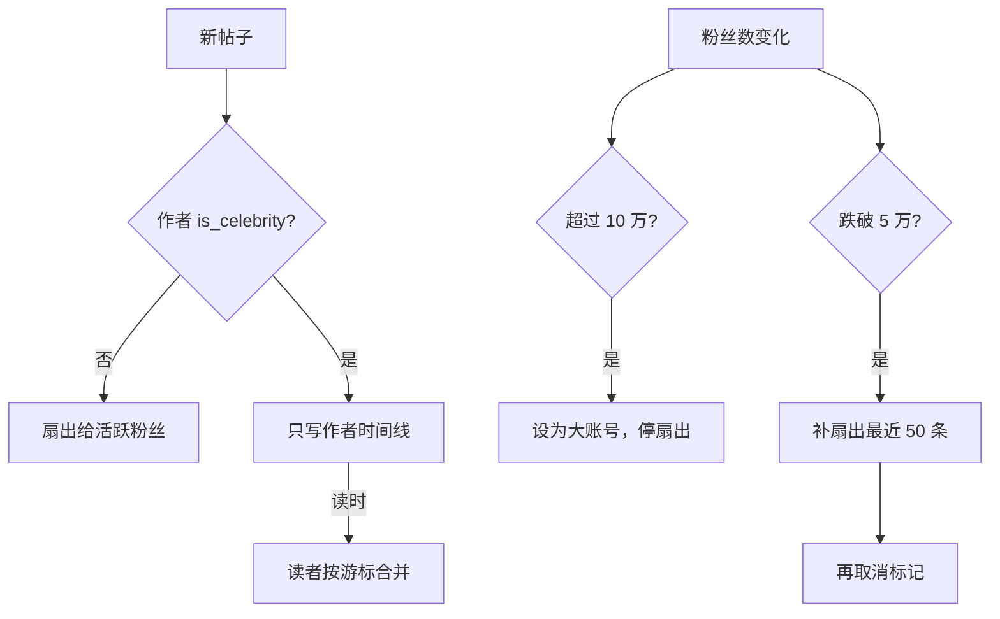

## Q
**混合扇出：阈值怎么定、账号跨阈值时怎么切换**｜完整答案 · 动态流（Facebook News Feed）

面试官：「你说大账号不扇出、读时合并。'大'的阈值是多少，用什么账算出来？一个账号粉丝从 9 万涨到 11 万、又掉回 9 万，切换的那一刻粉丝的动态会不会少帖？」

## A
**一句话。** 阈值来自两边成本的比较：扇出的代价是「活跃粉丝数 × 每天发帖数」次写，不扇出的代价是「每个粉丝每天刷新次数」次额外读；粉丝越多、发帖越勤越该读时合并，同时限制每个读者最多合并几十个大账号。切换用两个阈值加迟滞（升过 10 万变大账号，降到 5 万以下变回），降级时先把最近几十条补扇出一次再停止合并，切换前后都不缺帖。

**每条帖子和每次读取的分流。**

**步骤：定阈值。**
1. **写的账：** 粉丝 10 万、40% 活跃、每天 5 帖，约 20 万次写/天；粉丝 1 亿约 2 亿次/天，且集中在发帖后几十秒内，1 分钟写完要约 170 万次/秒。
2. **读的账：** 不扇出时每个活跃粉丝每次刷新多一次时间线读：10 万 × 40% × 10 次 = 40 万次读/天；命中缓存、可流水线、分散在全天，比写便宜。
4. **只算活跃粉丝：** worker 只写有收件箱的用户，阈值也按活跃粉丝数，不按总数。阈值从 10 万量级起步，看队列积压和读 p99 再调。

**步骤：切换。**
1. **升为大账号：** `is_celebrity` 存在作者表，调度器每条帖子读它；读者的大账号列表缓存几分钟，所以升级时先让读者开始合并（更新列表、清缓存）再停扇出，否则这几分钟新帖既不在收件箱也没被合并。
2. **降回普通账号：** 先把作者时间线最近 50 条走普通扇出补给活跃粉丝，完成后取消标记、读者停止合并。
3. **迟滞：** 上下阈值分开（10 万与 5 万），再加最短停留（如 7 天），避免反复切换、反复补扇出。

**故障。**
- **标记已变、读者缓存未变：** 升级先合并后停扇出，降级先补扇出后停合并，任何时刻至少一条路径覆盖该作者，重复帖在合并时按 `post_id` 去重。补扇出是普通 SQS 任务，可重试、幂等，完成前不取消标记。
- **大账号时间线缓存丢失：** 从 `(author_id, created_at)` 索引重建最近几百条，之前直接查索引，慢但正确。

**为什么这样。**
- 不只用一个阈值：粉丝数在阈值附近抖动会来回切换，每次降级都补扇出。
- 不按总粉丝数算：多数粉丝不活跃，会把便宜的账号错判成大账号，增加读者合并成本。

**数字。** 1 亿粉丝 × 40% 活跃 ÷ 60 秒 ≈ 67 万次写/秒，只为一条帖子，已接近全站平均扇出量的 3 倍；读者侧每次多几次时间线读，流水线后多一两毫秒；10 万 / 5 万阈值只是起点。
