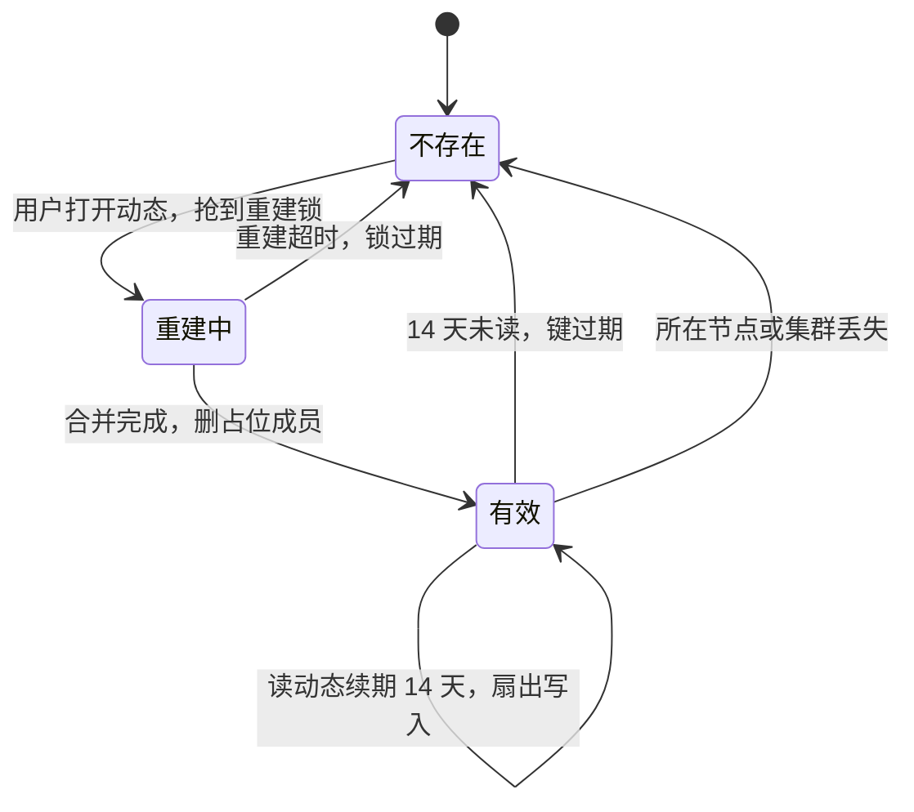

## Q
**收件箱的一生：建、过期、重建与修正**｜完整答案 · 动态流（Facebook News Feed）

面试官：「一个三个月没登录的用户回来了，他的收件箱在哪？谁、什么时候给他建？重建的几百毫秒里正好有人发帖，会不会漏？取消关注、删帖、新关注之后，已经写好的收件箱怎么办？一整个 Redis 集群丢了呢？」

## A
**一句话。** 收件箱只为活跃用户存在：每次读动态把过期续到 14 天，14 天没读自然过期，扇出 worker 见它不存在就跳过；用户回来时先用朴素读返回第一页，同时抢到重建锁的请求先建占位收件箱（让新帖扇出能写进来），再从关注表和作者时间线合并最近 800 条写入。删帖和取关在读时过滤，新关注回填对方最近的帖子；集群丢失就是大批用户同时重建，按速率放行。

**收件箱的状态。**

**步骤：回归用户的重建。**
1. **朴素读先顶上：** `EXISTS` 为 0 时，取最近活跃的若干关注作者，查 `(author_id, created_at)` 索引合并出第一页，几十到几百毫秒，慢但能打开。
2. **锁与占位：** `SET rebuild:{uid} <req_id> NX PX 30000`，只有一个请求重建，多设备并发的其他请求走朴素读；重建者先 `ZADD inbox:{uid} 0 __init` 占位（空有序集合在 Redis 里不存在），此后扇出的「存在才写」会把新帖写进来。
3. **合并与收尾：** 取每个关注作者最近的帖子（作者时间线缓存优先），合并取最新 800 条 `ZADD`，与扇出重叠无妨；`ZREM __init`、裁剪、释放锁。每次读执行 `EXPIRE inbox:{uid} 1209600`（14 天）续期。

**步骤：修正。**
1. **删帖与编辑：** 删帖在帖子表打 `deleted = true` 墓碑，读时跳过并补取；编辑只改帖子表并删正文缓存的一个键，不碰任何收件箱。
2. **取关：** 删关注边，缓存的关注集合失效，读时按它过滤，旧帖立刻不显示；后台再把对方帖子从该收件箱 `ZREM` 回收空间。
3. **新关注：** 把对方最近 20 条 `ZADD` 进关注者收件箱，立刻可见；对方是大账号则什么都不用做，读时已合并。

**故障。**
- **重建期间有人发帖：** 占位让收件箱先存在，扇出照常写入，合并时重复读到也只是重复 `ZADD`。重建请求崩溃则锁 30 秒后过期，下一次读重新抢，结果相同。
- **整个收件箱集群丢失：** 其上的活跃用户同时变成「不存在」，全部先走朴素读，重建按全局速率放行（如每秒几万个）避免打垮帖子表和关注表；收件箱按 `user_id` 拆成多个独立集群，一次故障只影响一部分用户。
- **关注两张表不一致：** 用 `TransactWriteItems` 同写，或主表写入后由变更流异步维护反向表并重试；落后的几秒里新粉丝收不到扇出，新关注的回填已补了最近的帖子。

**为什么这样。**
- 不把收件箱当事实：事实是关注表和帖子表，收件箱可丢可重建，Redis 不必每次写都落盘。

