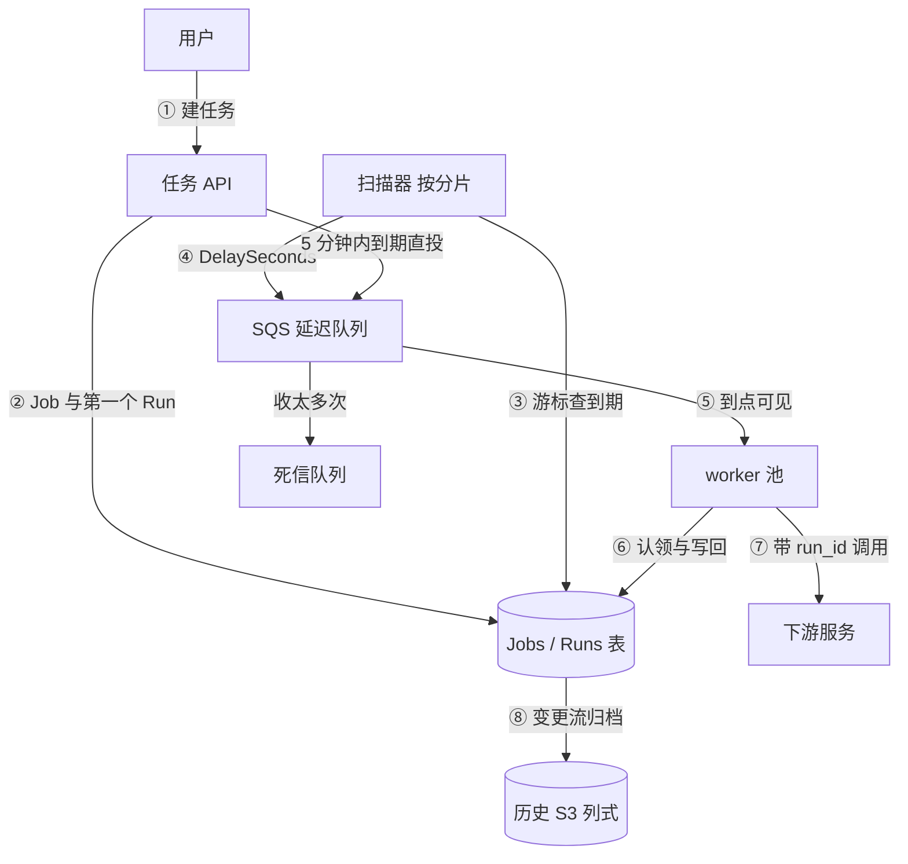

## Q
**全景**｜完整答案 · 分布式任务调度（Airflow）

面试官：「设计一个分布式任务调度器：用户提交立即执行、定时执行和按 cron 周期执行的任务，并能查看每次执行的状态。要求在计划时间后 2 秒内开始执行，峰值每秒 1 万个任务，至少执行一次。worker 随时会崩溃。从需求讲到深挖。」

## A
**一句话。** 任务定义存在 Jobs 表，每一次「该在某时刻执行」物化成 Runs 表一行，按（小时桶，写分片）分区；扫描器按分片分工，用游标把未来几分钟到期的 Run 条件更新为 `ENQUEUED`，带 `DelaySeconds` 发进 SQS，由队列负责准点。worker 收到消息先条件认领 Run（`attempt + 1`），执行期间用 `ChangeMessageVisibility` 续期；worker 死了续期停止，消息重新可见，下一个 worker 认领时 `attempt` 再加一，旧 worker 迟到的写回因 `attempt` 不匹配失败；副作用靠 `run_id` 幂等键去重。

**需求。** 立即、定时、cron 三类任务，查执行记录，失败自动重试；计划时间后 2 秒内开始、峰值每秒 1 万个、至少一次（恰好一次的效果靠幂等）；任何单个组件挂掉都不漏任务；不做 DAG 和改期。

**规模。** 平均为峰值的 1/3，Run 平均运行 2 秒，每条约 200 字节：

| 项 | 结果 |
|---|---|
| 平均速率 | 约 3,300 个/秒，每天约 2.9 亿 |
| 一年记录 | 约 1,000 亿条，16–21 TB，必须分热冷 |
| 扫描窗口 | 1 万/秒 × 5 分钟 ≈ 300 万条，约 600 MB |
| 在途 Run | 1 万 × 2 秒（利特尔法则）≈ 2 万；若平均 25 秒则 25 万，超过 SQS 标准队列约 12 万在途上限，要多个队列 |
| worker | 2 万 ÷ 每台 50 并发 ≈ 400 台，随积压伸缩 |

难点不在吞吐，而在三件事：2 秒精度（数据库扫不出来）、不重不漏的交接、worker 死了谁接手。

**实体与接口。** `Job`（`schedule` 是立即、某时刻或 cron 加 IANA 时区，另有 `retry_policy`、`overlap_policy`、`misfire_policy`）；`Run`（`run_id = job_id#scheduled_for`，`attempt` 兼作围栏令牌，`checkpoint` 存长任务进度）；`ShardLease`（`owner`、`lease_until`、`cursor`）。`POST /jobs` 带 `Idempotency-Key`；`GET /jobs/{id}/runs`；`DELETE /jobs/{id}` 停用，已入队的 Run 在认领时被状态检查拦下。

**架构。**

- **建任务（①–②）：** 一次事务写 Job 和第一个 Run。
- **调度（③–⑤）：** 数据库负责记住，队列负责准点。
- **执行（⑥–⑦）：** 认领、续期、写回都带 `attempt`，对外调用都带 `run_id`。
- **归档（⑧）：** 终态 Run 经变更流写进历史，热表只留近期。

**必讲深挖。**
- **物化：** cron 只物化下一个 Run，`run_id` 由（任务，计划时间）决定，重复物化是空操作。
- **调度：** 扫描器按分片持租约，条件更新 `SCHEDULED → ENQUEUED` 后才发 SQS，卡在 `ENQUEUED` 的由恢复扫描退回。
- **worker 故障：** 可见性超时是检测者，下一个收到消息的 worker 是接手者，`attempt` 是围栏，`run_id` 是幂等键。
- **重试：** 失败统一成「更晚的到期」，短退避用可见性延后，长退避写回数据库，超次数进 `DEAD`。

**为什么这样。**
- 不每 2 秒扫库：每次 2 万行、几百毫秒，精度上限仍是扫描间隔。
- 不用 Kafka 做延迟：分区内按序消费，晚到期的消息挡住早到期的，也没有单条可见性超时。
- 不让 worker 写数据库心跳：2 万在途每 5 秒一写就是 4,000 次/秒；可见性超时把存活检测放在队列里，只有长任务才续期。
- 不用 Temporal 跑每个 Run：每秒 1 万个简单任务各写一份事件历史，成本过高。

