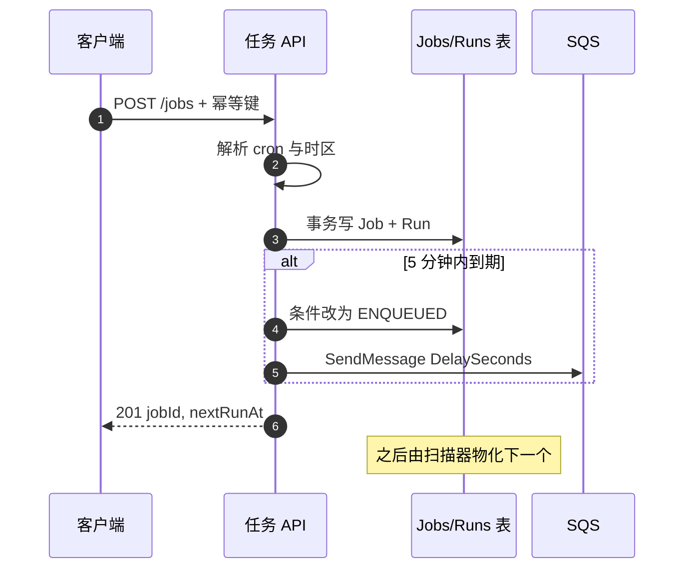

## Q
**建任务与物化：Job、Run 和下一次触发**｜完整答案 · 分布式任务调度（Airflow）

面试官：「用户提交"每天纽约时间 10 点给我发日报"。这条请求进来后写什么、写在哪？下一次执行由谁、在什么时候算出来？上一次还没跑完，下一次到点了怎么办？调度器停了两小时，错过的执行怎么处理？」

## A
**一句话。** 任务 API 用一个事务写入 Job 和第一个 Run；Run 主键 `job_id#scheduled_for` 由计划时间唯一决定，重复物化是空操作。之后扫描器每入队一个 Run，顺手按 cron 和 IANA 时区算出下一次的 UTC 时刻并条件写入；下一次按「计划时间」递推而不是「上次跑完时间」，所以跑得慢、失败、重试都不会让周期漂移或断链。

**建任务。**

**步骤。**
1. **校验与幂等：** 解析 cron 和时区名 `America/New_York`，拒绝固定偏移（`-05:00`，夏令时当天错一小时）；`job_id` 由 `Idempotency-Key` 派生，客户端重试得到同一个。
2. **一个事务写两行：** `TransactWriteItems` 的 `Put Job` 与 `Put Run` 各带 `attribute_not_exists`，不会有没有 Run 的孤儿 Job。
3. **Run 的键：** 分区键 `bucket#shard`（如 `2026-11-15T15#07`，UTC 小时加 `hash(job_id) % 16`），排序键 `scheduled_for#run_id`；分片用哈希而非随机数，同一任务的 Run 总在同一分片，按 `run_id` 直接定位。
4. **近期直投：** 5 分钟内到期的游标可能已越过，API 自己改 `ENQUEUED` 并发 SQS（`DelaySeconds` 最多 900 秒）。
5. **物化下一个：** 扫描器入队 Run#n 时条件写入 Run#n+1，两个扫描器重复做时第二次因 `attribute_not_exists` 失败，无害；一次性任务不物化。

**cron 的三个语义问题。**
- **重叠：** `overlap_policy`：`ALLOW` 并行（默认，每个 Run 处理自己的时间区间），`SKIP` 认领前查有无 `RUNNING` 的则标 `SKIPPED`，`QUEUE` 延后到上次结束。
- **错过：** Run 已物化不会丢，恢复后看到一批过期的 `SCHEDULED`。`misfire_policy`：`RUN_ALL` 逐个补（按小时汇总必须如此），`RUN_ONCE` 只补最新一个（提醒、刷缓存），`SKIP` 全跳过；再加最大迟到时长，补跑要限速，别把 2 小时的量一秒塞进队列。
- **夏令时：** 春季不存在的 02:30 顺延到间隙后第一刻，秋季出现两次的 01:30 只执行第一次；全在物化时用带时区的库算，表里只存 UTC。

**故障。**
- **事务写完、响应前崩溃：** 同一幂等键重试，`Put Job` 条件失败，读出已有 Job 返回。
- **物化下一个时扫描器崩溃：** 恢复扫描查「有 cron 却没有未来 Run」的 Job 补写，`run_id` 确定，不会重复。
- **停用任务：** Job 标 `disabled`，已物化的 Run 在扫描或认领时检查并标 `CANCELED`。

**为什么这样。**
- 不每次现算 cron：每分钟对上亿个表达式求值不可扩展；物化成带时间的行，扫描就是一次范围查询。
- 不一次物化一年：写放大、改期难；只物化下一个，Run 数约等于活跃任务数。
- 不在 Run 完成时才算下一个：长任务或重试会推迟甚至打断周期。
- `run_id` 不用随机 UUID：随机 ID 让重复物化变成两个 Run。

**数字。** `DelaySeconds` 0–900 秒，直投窗口和扫描提前量都要小于 15 分钟；`TransactWriteItems` 最多 100 个操作，这里只用 2 个。
