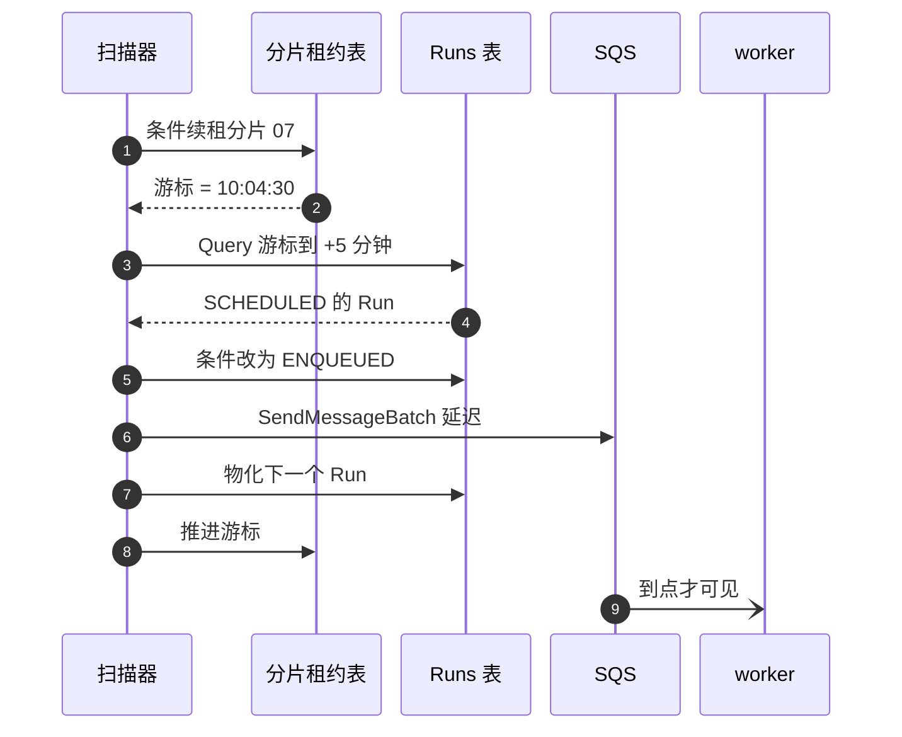

## Q
**调度路径：扫描器、条件认领与延迟队列**｜完整答案 · 分布式任务调度（Airflow）

面试官：「表里有上亿个将来要跑的 Run。谁把即将到期的找出来、交给 worker？怎样做到 2 秒精度？扫描器自己挂了、两个扫描器扫到同一条、认领之后入队之前崩溃，分别会怎样？」

## A
**一句话。** 16 个写分片各有一个扫描租约；每 30 秒每片从自己的游标查到「现在 + 5 分钟」，对每个 `SCHEDULED` 的 Run 先条件更新为 `ENQUEUED`，成功才 `SendMessageBatch`（`DelaySeconds` = 到期 − 现在），再推进游标、物化下一个 Run。精度交给 SQS：消息到期才对 worker 可见，长轮询下开始延迟通常 1 秒内。

**一轮扫描。**

**步骤。**
1. **抢租约：** 条件写 `lease_until < :now OR owner = :me`，分片分给几个实例，各扫各的。
2. **范围查询：** 小时桶内查 `游标-30秒` 到 `now+5分钟`，30 秒回退重叠覆盖边界写入。
3. **条件认领：** `SET #st = 'ENQUEUED' ConditionExpression #st = 'SCHEDULED'`，重叠或两个扫描器扫到同一条时只有一个成功。
4. **入队：** 成功的一批 `SendMessageBatch`（每批最多 10 条），已过期的延迟为 0。
5. **物化并推进游标：** cron 任务条件写入下一个 Run；游标写带 `owner = :me`，租约被抢走则写失败，扫描器停手。

**故障。**
- **实例崩溃：** 租约 30 秒后过期，别的实例从游标继续；5 分钟提前量吸收这段延迟。
- **两个实例同时认为自己持有分片：** 条件认领让同一个 Run 只入队一次，游标条件写让旧主人推不动进度。
- **认领后、入队前崩溃：** Run 停在 `ENQUEUED` 却不在队列里；恢复扫描每分钟把 `ENQUEUED` 超过 60 秒且未开始的退回 `SCHEDULED`。代价是极少数重复投递，由 worker 认领和下游幂等兜住。必须先认领再入队，反过来会双发。
- **扫描落后：** 游标离现在超过 2 分钟告警；静默不干活是最危险的故障，所有任务一起迟到。

**为什么这样。**
- 租约只减少争用，正确性靠 Run 行上的条件认领。
- 窗口不拉到一小时：`DelaySeconds` 上限 900 秒，窗口越大被取消、改期的已入队消息越多。
- 用游标而不是 `status = SCHEDULED` 过滤：DynamoDB 过滤在读出后才执行，读容量照算。

**数字。** 峰值每秒 1 万个，30 秒一轮约 30 万条，每片约 1.9 万条；队列常驻约 5 分钟的量，约 300 万条、600 MB。
