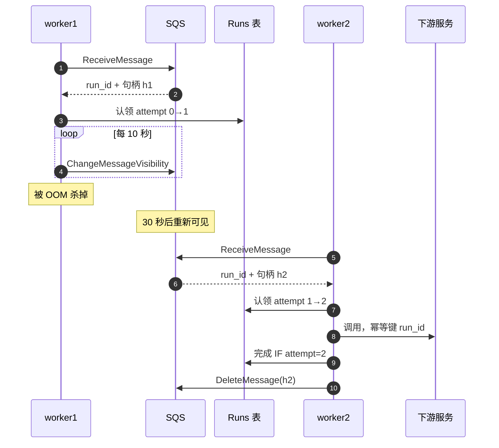

## Q
**worker 崩溃：谁发现、谁接手、旧 worker 醒来怎么办**｜完整答案 · 分布式任务调度（Airflow）

面试官：「worker 取到一个 Run，执行到一半进程被 OOM 杀掉。具体是哪个组件发现的？多久之后谁接手？接手的 worker 怎么知道前一次做到哪？如果前一个 worker 不是死了，而是 GC 停顿了 40 秒又醒来继续写结果呢？」

## A
**一句话。** 存活检测只有一处：SQS 可见性超时。worker 收到消息先条件认领 Run 行（`attempt` 加一），执行期间每 10 秒 `ChangeMessageVisibility` 续期到 30 秒；进程死了续期停止，最多 30 秒后消息重新可见，下一个 `ReceiveMessage` 的 worker 就是接手者，认领时 `attempt` 再加一。`attempt` 是围栏令牌：所有对 Run 行的写（检查点、完成、失败）都带 `attempt = 我的值`，旧 worker 醒来后的写全部失败；对下游的副作用用跨尝试不变的 `run_id` 做幂等键。

**一次崩溃与接手。**

**步骤。**
1. **取消息与认领：** 长轮询取消息，可见性超时 30 秒；续期和删除要用最近一次接收的回执句柄。`UpdateItem` 条件 `#st IN ('ENQUEUED','RUNNING','RETRY_WAIT') AND attempt < :max`，`SET attempt = attempt + 1, worker_id = :me`；允许从 `RUNNING` 认领，因为消息能再次被收到本身就说明上一位停止了续期。已 `SUCCEEDED`、`CANCELED`、`DEAD` 则直接删消息不执行。
2. **续期即心跳：** 每完成一块工作续期一次，间隔约超时的 1/3，丢一两次也不会过期；续期绑在真实进展上，不另起定时线程，否则死锁的任务会被永远续下去。
3. **崩溃与接手：** 没有任何组件「看到」它死了，续期停止满 30 秒消息回到可取状态，另一个 worker 取到并认领，`attempt` 1 → 2，此后旧 worker 用 `attempt = 1` 的写都匹配不到；长任务从 `checkpoint` 续跑，短任务重做。
4. **下游与完成：** 邮件、扣款按 `run_id` 去重（两次尝试间不变；`attempt` 只用来围自己的表）。`SET #st = 'SUCCEEDED'` 条件 `attempt = :2 AND #st = 'RUNNING'`，之后才 `DeleteMessage`；反过来删完还没写完成就崩溃，Run 会永远停在 `RUNNING`。

**僵尸 worker。** worker1 GC 停顿 40 秒，超过 30 秒超时，worker2 已以 `attempt = 2` 接手；worker1 醒来不知道被替换。
- **写检查点或完成：** `attempt = :1` 条件失败，worker 把 `ConditionalCheckFailedException` 当作「我已被取代」，立刻停手不删消息；长任务每块都写检查点，僵尸最多多做一块。
- **已发出的副作用：** 围栏挡不住，靠下游按 `run_id` 去重；下游不支持幂等键时，先在 Run 行记「副作用已发出」再调用，接手者见标记就跳过，代价是「记了没发」变成至多一次。

**故障。**
- **整机或可用区掉线：** 几百个 Run 的消息 30 秒后一起重新可见被接走，按积压伸缩补容量。
- **进程卡死：** 续期绑进展，卡住不续，30 秒后被接手；存活探针重启进程，二者各管一层。
- **重复投递：** 标准队列至少一次，worker1 仍在续期时 worker2 也可能收到；两个并行，worker1 下次检查点写失败停手，下游按 `run_id` 去重。

**为什么这样。**
- 不再加数据库租约：两套存活检测会互相矛盾，还要每个在途 Run 定期写库；队列独占检测，表只做围栏。
- 不用中心健康检查轮询 worker：知道谁死了还得知道它手里有哪些 Run，正是队列已做的事。

