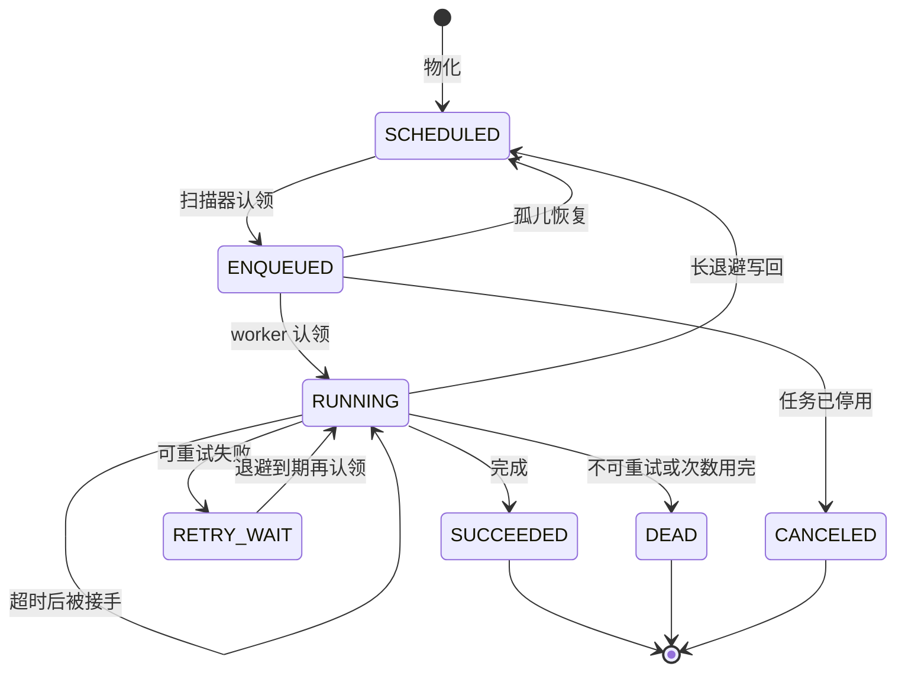

## Q
**Run 的状态机：失败分类、重试、死信与发布**｜完整答案 · 分布式任务调度（Airflow）

面试官：「worker 故障不止崩溃一种。任务代码抛异常、参数错误、某条任务每次都把 worker 弄崩、下游服务宕机一分钟、我们自己滚动发布 worker，各自由谁发现、怎么处理？重试次数记在哪里？什么时候放弃？」

## A
**一句话。** 每个 Run 是一行状态机，`attempt` 记在 Run 行上、每次认领加一，既是重试计数也是围栏。所有失败归结为三种出口：可重试的变成「更晚的到期」（短退避用 `ChangeMessageVisibility` 延后同一条消息，长退避写回 `SCHEDULED`），不可重试的直接 `DEAD`，次数用完也 `DEAD`。毒任务靠认领时 `attempt < max` 拦下，连认领都到不了的消息由 `maxReceiveCount` 送进死信队列。

**Run 状态机。**

**失败分类。**

| 失败 | 谁发现 | 谁处理 |
|---|---|---|
| 可重试异常（超时、5xx、限流） | worker 捕获 | 写 `RETRY_WAIT`、延后消息 |
| 参数、权限错误 | worker 按错误类型 | 直接 `DEAD`，删消息，告警所有者 |
| 崩溃、卡死、掉线 | 可见性超时到期 | 下一个收到消息的 worker，`attempt` 围栏加 `run_id` 幂等 |
| 毒任务（每次弄崩 worker） | 每次崩溃 `attempt` 加一 | 第 max 次认领条件失败，写 `DEAD` |
| 消息本身坏了 | 认领都做不了 | `maxReceiveCount` 进死信，对账发现并标 `DEAD` |
| 下游宕机 | 失败率突增 | 熔断该任务类别，退避加抖动 |

**重试步骤。**
1. **判断与退避：** 只有超时、5xx、限流重试，4xx 和参数错误直接 `DEAD`，由处理器声明；`delay = random(0, min(上限, 基数 × 2^attempt))`，全抖动让同一秒失败的一批错开。
2. **短退避（几秒到几分钟）：** 条件写 `RETRY_WAIT` 后 `ChangeMessageVisibility(delay)`，同一条消息延后重现，不发新消息也不删旧消息，没有「发了新的没删旧的」的重复。
3. **长退避（超过几分钟）：** 条件写回 `SCHEDULED`，`scheduled_for = now + delay`，删消息，由扫描器到时重新入队；重试和首次执行走同一条路。
4. **放弃：** 第 max+1 次收到消息时认领失败，worker 写 `DEAD`、删消息、告警；死信队列的 `maxReceiveCount` 设 max + 3，只接连 Run 行都写不了的消息，有告警和人工重放。

**发布与缩容。** 收到 SIGTERM 停止收新消息；短任务在宽限期（Kubernetes 默认 30 秒）内做完；长任务写一次检查点再 `ChangeMessageVisibility(0)`，别的 worker 马上从检查点接手，不用等 30 秒；分批滚动，避免大量交还造成重试尖峰。

**故障。**
- **下游宕机 60 秒：** 1 万/秒全部失败，最坏每个 Run 尝试 4 次。按类别统计失败率，超阈值熔断：消息延后且不消耗 `attempt`，探测成功再放行；熔断超几分钟改写回 `SCHEDULED` 并删消息，免得接收次数累积被误送死信。

**为什么这样。**
- 不只用 `ApproximateReceiveCount`：它是近似值，熔断延后和主动交还也让它增加；`attempt` 在 Run 行上，确定可查。
- 不删旧消息再发带 `DelaySeconds` 的新消息：两步之间崩溃会丢任务，反过来会重复；延后同一条是一步。

**数字。** 退避基数 2 秒、上限 5 分钟、最多 5 次；可见性延后上限是首次接收起 12 小时，超过就写回 `SCHEDULED`；崩溃最多 30 秒发现，毒任务最多 max 个可见性超时后进 `DEAD`。
