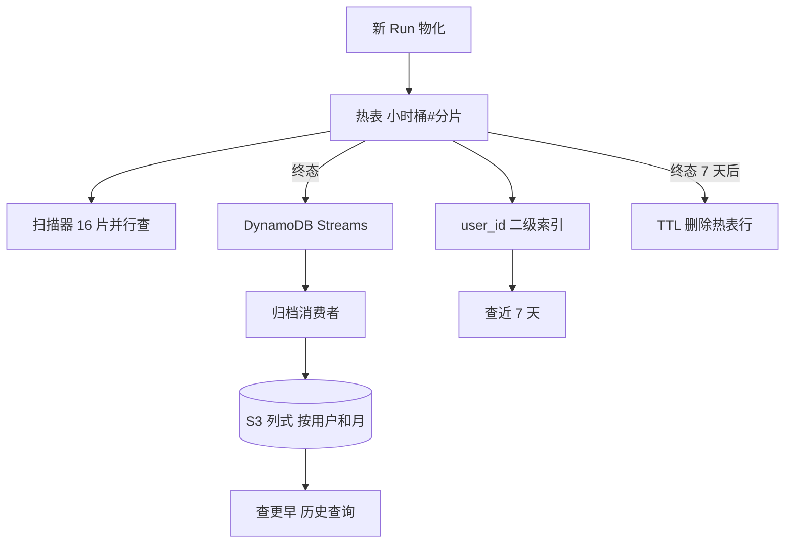

## Q
**规模：热分区、一年的执行历史与用户查询**｜完整答案 · 分布式任务调度（Airflow）

面试官：「每秒 1 万个 Run 都写进当前小时的分区，DynamoDB 单分区扛得住吗？一年 1,000 亿条执行记录放在哪？用户要查"我上个月失败的执行"，怎么查又不拖慢调度？」

## A
**一句话。** 调度用的 Runs 热表只装「未来的和最近几天的」Run：分区键（UTC 小时桶，`hash(job_id) % 16`）把当前小时的写分散到 16 个分区。Run 进入终态后 DynamoDB Streams 交给归档消费者，按（用户，月份）写成列式文件放进 S3，热表行几天后由 TTL 删除。用户查近 7 天走热表的 `user_id` 全局二级索引，更早的走 S3 上的历史表；调度永远只碰热表的 1–2 个小时桶。

**数据的一生。**

**步骤。**
1. **写分片：** 当前小时写进 `bucket#00` 到 `#15`，分片号用 `job_id` 的哈希，同一任务的 Run 在同一分片，更新状态按主键直达；扫描器每个分片单独查，由租约分给不同实例，读放大被分摊。
2. **用户索引：** GSI 分区键 `user_id`、排序键 `scheduled_for`，投影状态和错误摘要，代价是每次写 Run 多一次索引写。
3. **归档：** 终态（`SUCCEEDED`、`DEAD`、`CANCELED`）出现在 Streams 里，消费者按（用户，月份）攒批，每几分钟写一个 Parquet 到 `s3://runs-history/user=…/month=…/`；写终态时设 `expire_at = 终态时间 + 7 天`，TTL 异步删除，不占写容量。
4. **查历史：** 7 天内查 GSI，更早的用 Athena 按（用户，月份）分区扫 S3，API 层按时间合并分页；一年后整月文件由 S3 生命周期规则删除或转冷。

**故障。**
- **单个任务特别热：** 按任务量给大任务加盐 `hash(job_id, scheduled_for 的分钟) % 16`，牺牲按主键直达换分散。
- **归档消费者落后或崩溃：** Streams 保留 24 小时，消费者从检查点继续；终态行 7 天后才删，远大于 24 小时，数据不会在归档前消失。重放写出的重复行按 `run_id` 去重，归档幂等。
- **扩分片数：** 只对新小时桶生效，扫描器按桶记录的分片数查询，旧桶自然过期不迁移。
- **GSI 写被限流：** GSI 容量不够会反压基表写入，`user_id` 分布均匀，按峰值预留。

**为什么这样。**
- 不把一年历史留在热表：20 TB 的表里扫描、备份、恢复都变慢，大部分数据再也不会被调度读到。
- 不逐行 DELETE：每天删 2.9 亿行和写入一样贵；TTL 和按月整批丢文件不花写容量。
- 不用随机数当写分片：同一 Run 的后续更新得先查出它在哪一片。
- 不让归档在 worker 完成路径上同步做：归档失败不能影响调度。

**数字。** 峰值 1 万写/秒 ÷ 单分区约 1,000 WCU = 10 片，取 16 片留余量，每片约 625 写/秒；热表 = 活跃任务数的未来 Run 加 7 天终态 2.9 亿 × 7 ≈ 20 亿行、约 400 GB；DynamoDB 单项 400 KB 上限，所以 Run 行只放摘要，输出和日志放 S3 只存键。
