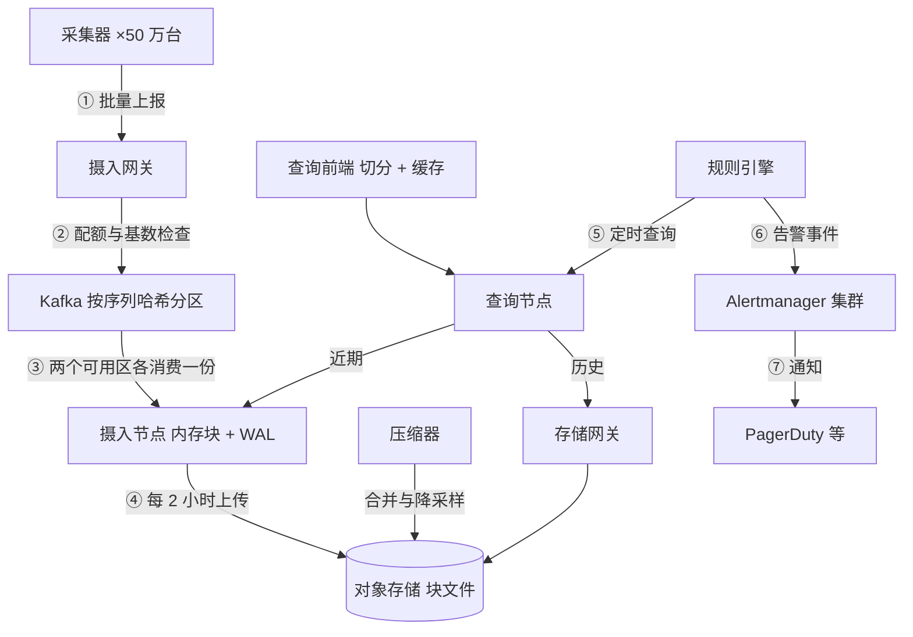

## Q
**全景**｜完整答案 · 指标监控（Datadog）

面试官：「设计一个类似 Datadog 的指标监控平台：50 万台服务器上报指标，工程师在仪表盘上查询，规则越线时 1 分钟内通知到人。从需求讲到深挖。」

## A
**一句话。** 每台机器的采集器先本地聚合、压缩、批量，经摄入网关做配额和基数检查后写进 Kafka（按序列哈希分区）；每个分区由两个可用区各一个摄入节点消费，在内存里按时间块压缩样本、写 WAL，每 2 小时切出不可变块上传对象存储，再由压缩器合并降采样。查询前端把仪表盘查询按天切分、对齐步长、缓存历史结果，近期问摄入节点，历史问存储网关。告警是规则引擎按固定间隔执行的查询，状态（pending / firing）持久化，事件交给 Alertmanager 集群去重、分组、发送。

**需求。** 摄入计数器、仪表、直方图；按标签过滤聚合并画图；「越线并持续一段时间」的告警，通知 Slack、PagerDuty、邮件并支持静默。不做日志、追踪、异常检测。点产生后约 30 秒可查，越线到通知 < 1 分钟，跨几周的面板几秒返回；告警比仪表盘重要，系统自己故障时宁可晚不可错、不可静默；迟到乱序点要正确处理。

**规模。** 每台每 10 秒报 100 个点，压缩后每样本约 1.5 字节：

| 项 | 结果 |
|---|---|
| 样本速率 | 5×10⁵ × 100 ÷ 10 = 500 万点/秒 |
| 活跃序列 | 5×10⁵ × 100 = 约 5,000 万，内存索引按它算 |
| 未压缩带宽 | 500 万 × 约 150 字节 ≈ 0.75 GB/s |
| 压缩后存储 | 500 万 × 1.5 B × 86,400 ≈ 650 GB/天 |
| 告警评估 | 1 万规则 ÷ 60 秒 ≈ 170 次查询/秒 |

**架构。**

- **写路径（①–④）：** 采集器聚合批量，网关挡超限，Kafka 持久缓冲，摄入节点管近期数据。
- **读路径：** 查询前端做缓存与切分，历史在对象存储。
- **告警路径（⑤–⑦）：** 评估复用查询路径，通知是单独的有状态层。

**必讲深挖。**
- **摄入：** 采集器持久队列加指数退避；网关按 `(agent_id, batch_seq)` 去重；Kafka `acks=all`；同序列进同分区，按序追加。
- **存储引擎：** WAL + 内存头块 + 增量的增量与异或压缩，2 小时切块，压缩器降采样为 5 分钟、1 小时，保留期到整块删除。
- **查询：** 倒排索引求交得序列，按范围选分辨率，缓存已封口的历史块。
- **告警：** 规则按组分片，`for` 状态持久化；两套引擎同时评估，Alertmanager 用 gossip 去重；看门狗告警兜底。

**为什么这样。**
- 不用关系库：每秒 500 万行插入、按时间扫、保留期删除，在 B 树上全是随机写和大删除；时序库只追加、按块删。
- 不从中心拉 50 万台：跨网络、跨租户、短任务都难；用推送，存活靠单独的 `up` 心跳序列。
- 不让网关直写存储：存储一慢网关就得丢数据或拖住采集器；Kafka 解耦且可重放。

