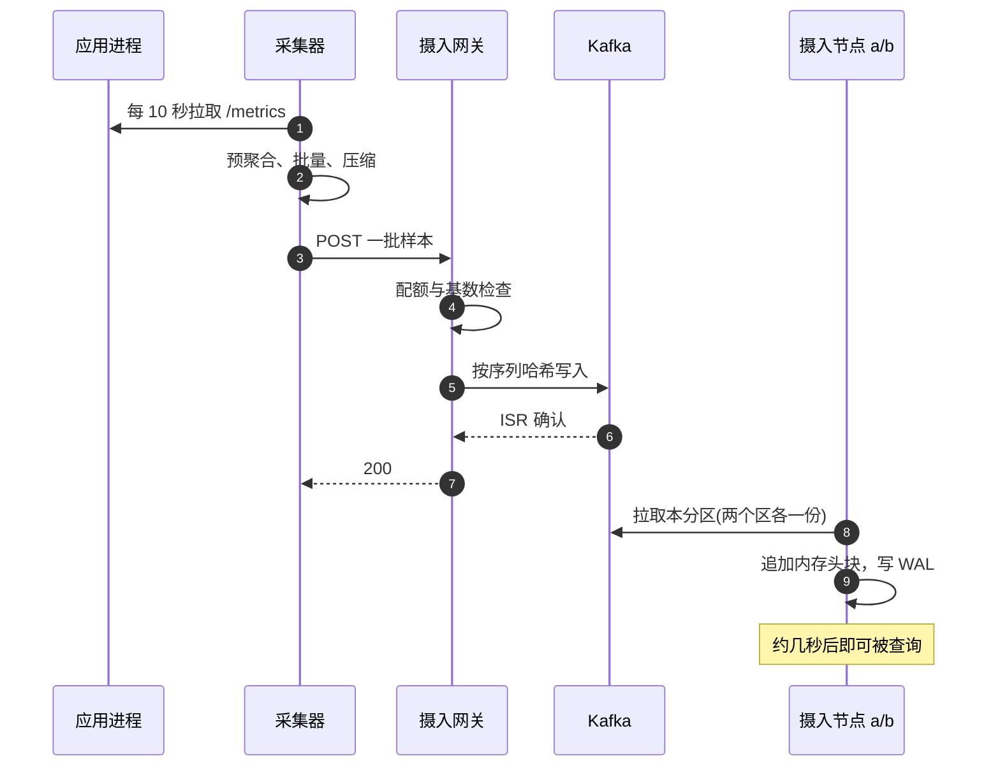

## Q
**摄入路径：采集器、网关、Kafka 与摄入节点**｜完整答案 · 指标监控（Datadog）

面试官：「一个点从应用里的计数器到能被查询，经过哪些组件？网关挂了、Kafka 慢了、某个摄入节点崩溃，数据会不会丢、会不会重复、谁来接手？」

## A
**一句话。** 应用把计数器暴露给本机采集器，采集器每 10 秒把一批样本压缩后发给摄入网关，失败进本地持久队列按指数退避重试；网关检查租户配额和基数后，以序列哈希为 key、`acks=all` 写入 Kafka 才回 200；每个分区固定由两个可用区各一个摄入节点消费，追加进内存头块并写 WAL、记下位点。任何一步重试都只会重写同一个（序列，时间戳），时序库对它天然幂等。

**请求流程。**

**步骤。**
1. **采集器：** 应用只维护累计值（计数器、直方图桶）暴露在 `/metrics`，进程重启归零由 `rate()` 识别；采集器去掉不需要的标签并合并同（指标，标签）的值，延迟类保留直方图桶，不在本地算 p99。每 10 秒一批，protobuf 加 snappy，带 `agent_id` 和递增 `batch_seq`。
2. **本地持久队列：** 发送失败进磁盘队列（Collector 的 `sending_queue` 配 `storage` 扩展，默认只在内存），指数退避加抖动：初始 5 秒、系数 1.5、最长 30 秒、累计 300 秒放弃（Collector 默认值，按断网容忍时间调大）；抖动让网关恢复时 50 万台不在同一秒补发。
3. **网关检查：** 无状态；租户样本速率配额（本地令牌桶按网关数分摊）、标签白名单与长度上限、活跃序列上限；超限返回 429 并计数，不默默丢弃。
4. **写 Kafka：** key = `hash(tenant, 序列标签)`，同序列同分区；`acks=all`、复制因子 3、`min.insync.replicas=2`；确认后才回 200，采集器才删本地批次。网关可按 `(agent_id, batch_seq)` 短窗口去重，漏了也无妨，重复样本被摄入节点忽略。
5. **摄入节点：** 分区 p 固定给 `ingester-a-p` 和 `ingester-b-p`（两个区），各自独立消费同一份，不是消费者组二选一；先写 WAL 再更新内存。头块接受 `out_of_order_time_window` 内的乱序点，更早的报错计数，走回填通道（离线生成块上传）。

**故障。**
- **Kafka broker 宕机：** 领导者切到同步副本；`min.insync.replicas` 不满足时网关回 503，数据留在采集器队列。
- **摄入节点崩溃：** 存活探针重启（StatefulSet 保留磁盘），先重放 WAL 再从记下的位点续消费；期间另一个区照常服务，查询只问健康的那份。磁盘也丢了就从 Kafka 上次上传块之后的位点重建，所以 Kafka 保留期要长于「块上传周期 + 恢复时间」，比如 24 小时以上。
- **机器宕机或时钟错：** 机器死了数据本就没有，由 `up` 序列和 `absent()` 发现；时钟错几小时的样本落在乱序窗口外被拒，网关也可拒绝超前几分钟的时间戳。

**为什么这样。**
- 不用消费者组抢分区：再均衡时新主人内存里没有头块，查询短暂缺数据；固定归属加两区各一份，重启只影响自己。

