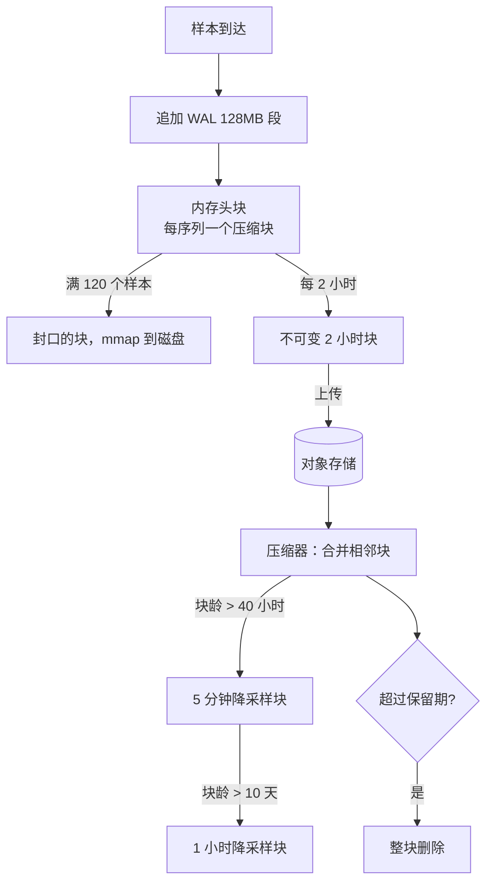

## Q
**存储引擎：头块、WAL、切块、压缩与降采样**｜完整答案 · 指标监控（Datadog）

面试官：「每秒 500 万个样本，存储引擎内部怎么写才扛得住？数据怎么从内存走到长期存储？一年前的数据怎么还能秒级查出来，保留期到了怎么删？」

## A
**一句话。** 摄入节点把每条序列最近的样本放在内存头块里，用时间戳「增量的增量」加值的异或（Gorilla 压缩）编码，平均每样本 1–2 字节，写入前先追加 WAL；头块每 2 小时封口成不可变块（样本块 + 倒排索引）上传对象存储；压缩器合并小块，并为老块生成 5 分钟、1 小时的降采样版本（每点存 count、sum、min、max、counter）；保留期到了整块删除。所有写都是顺序追加，没有原地更新。

**数据的一生。**

**步骤。**
1. **WAL 与头块：** 批先顺序追加 WAL（Prometheus 每段 128 MB）再进内存，崩溃重放；只保近 2–3 小时。头块每条序列一个压缩块：时间戳存间隔的差的差，采集稳定时几乎全 0、每个 1 位；值与上一个异或，只存少数有效位；满 120 个样本封口并 mmap 到磁盘，内存只留索引。
2. **倒排索引：** `标签=值 → 序列 ID 有序列表`，`service="cart" AND status="500"` 就是两张有序列表求交。
3. **切块与压缩：** 每 2 小时写成一个块目录（`chunks/`、`index`、`meta.json` 含最小最大时间）上传 S3 后删本地；压缩器合并相邻块并去掉两个区副本写出的重复样本，块越少查询打开的索引越少。
4. **降采样：** 以 Thanos 为例，块龄超 40 小时生成 5 分钟版本，5 分钟数据超 10 天生成 1 小时版本；因为有 count、sum、min、max、counter，平均、尖峰、速率都还能算，直方图按桶各自降采样，分位数仍可合并。
5. **保留与读块：** 保留按租户配置（如原始 15 天、5 分钟 90 天、1 小时 2 年），按块 `maxTime` 整块删除，没有逐行删除的写放大。存储网关只缓存块索引头部，用 range GET 读需要的几段，块的 min/max 让查询跳过范围外的块。

**故障。**
- **上传到一半崩溃：** 没有 `meta.json` 的块视为不完整，压缩和查询都忽略，重启后整块重传。
- **压缩器崩溃：** 新块写完 `meta.json` 才算存在，源块先打删除标记、过一段时间再真删，给在读的查询留余地；重启后重新合并，结果相同。两个压缩器处理同一批块会产生重叠块，Thanos 要求每桶只跑一个，Mimir 按租户和时间范围分片。
- **迟到很久的数据：** 超出乱序窗口的走回填：离线生成块直接上传，下一轮压缩合并，并让相关降采样和查询缓存失效。

**为什么这样。**
- 不把块长期放本地盘：容量有限、扩缩容要搬数据；对象存储便宜持久，计算节点变成无状态缓存层。

**数字。** Gorilla 论文约 1.37 字节/样本，未压缩是 16 字节（8 字节时间戳加 8 字节浮点）；500 万点/秒 × 1.5 B × 86,400 ≈ 650 GB/天，保留 15 天原始约 10 TB；小块 120 个样本，10 秒间隔约 20 分钟。
