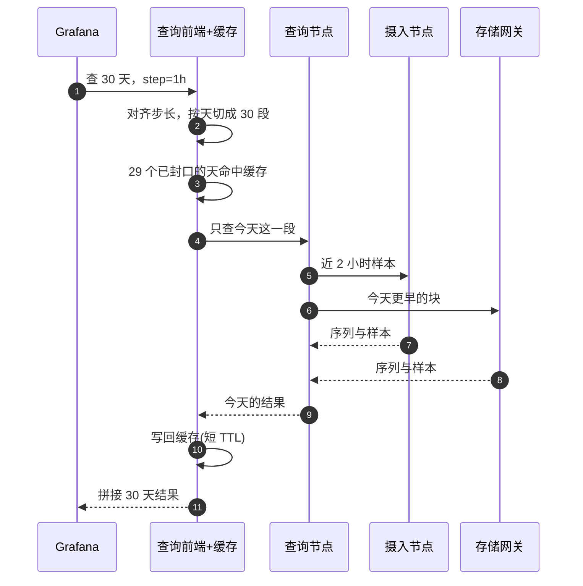

## Q
**查询路径：切分、缓存、选分辨率与扇出**｜完整答案 · 指标监控（Datadog）

面试官：「一个工程师打开 30 天的仪表盘，10 个面板，每 30 秒刷新，同时有 200 人在看。一条查询从 Grafana 到出图经过哪些组件？怎么做到几秒内返回、又不把存储打垮？」

## A
**一句话。** 查询前端先把时间范围对齐到步长、按天切成子查询，已封口的天直接读结果缓存，只有最近一天真正下发；查询节点用倒排索引求交找序列，按「范围 ÷ 步长」选最粗够用的分辨率，近 2 小时问摄入节点、更早的问存储网关，合并后按序列聚合。相同的并发查询只执行一次，超出租户限额的查询被拒绝而不是拖垮别人。

**一次面板查询。**

**步骤。**
1. **对齐与切分：** `start`、`end` 向下取整到 `step` 的整数倍，否则每次刷新 `now` 不同，缓存键永不重复；按天切成子查询并行，单段失败只重试这一段。
2. **结果缓存与合并：** 缓存键（租户，规范化查询，步长，那一天）；早于乱序窗口的整天不会再变，长期缓存，含「现在」的那段只缓存几十秒；同键并发请求只放一个去后端（single-flight），200 人开同一个仪表盘只算一次。
3. **选分辨率：** `step` ≥ 1 小时用 1 小时降采样块，≥ 5 分钟用 5 分钟块，否则原始块，目标每条序列返回几百到一千多点。
4. **找序列与路由：** 每个 `标签=值` 取倒排列表求交；正则 `=~` 先在标签值字典上匹配再并集，只应用于低基数标签。最近约 2 小时问摄入节点（两区副本任选健康的），更早的问存储网关，块 min/max 跳过无关块，合并时去重。
5. **聚合下推与限额：** `sum by (service)` 先在存储网关或摄入节点做一部分再合并；每租户限制并发数、单查询触达的序列数和样本数、最长执行时间，超限报错并提示加过滤或粗步长。

**故障。**
- **摄入节点挂了：** 改问另一区副本；两个都不可用就返回结果并标「部分数据」，不白屏。
- **存储网关慢：** 每块由多个网关副本负责，对慢副本发对冲请求（等一小会没回就再发另一个副本，用先回的）。
- **回填改变已缓存的历史：** 缓存只存早于乱序窗口的天；回填上传新块后按租户和时间范围让缓存失效。

**为什么这样。**
- 不直接查原始数据：30 天 × 1,000 序列 × 10 秒约 2.6 亿点、约 26 GB，1 小时降采样只有 72 万点。
- 不对所有存储节点广播：只问时间范围内的块和负责它的网关，成本取决于数据量而非节点数。

**数字。** 200 人 × 10 面板 ÷ 30 秒约 67 次/秒，合并与缓存后后端只算每个唯一查询每个步长一次；30 天切 30 段，命中缓存后只算 1 段，计算量约降到 1/30。
