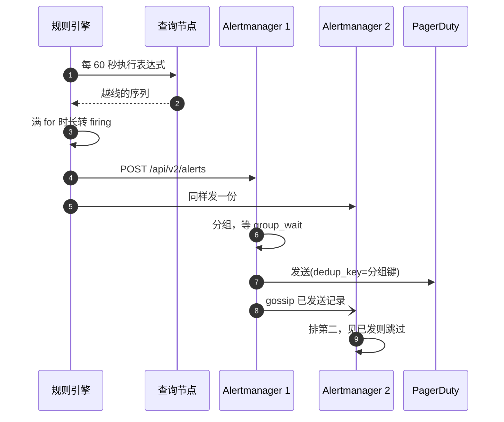
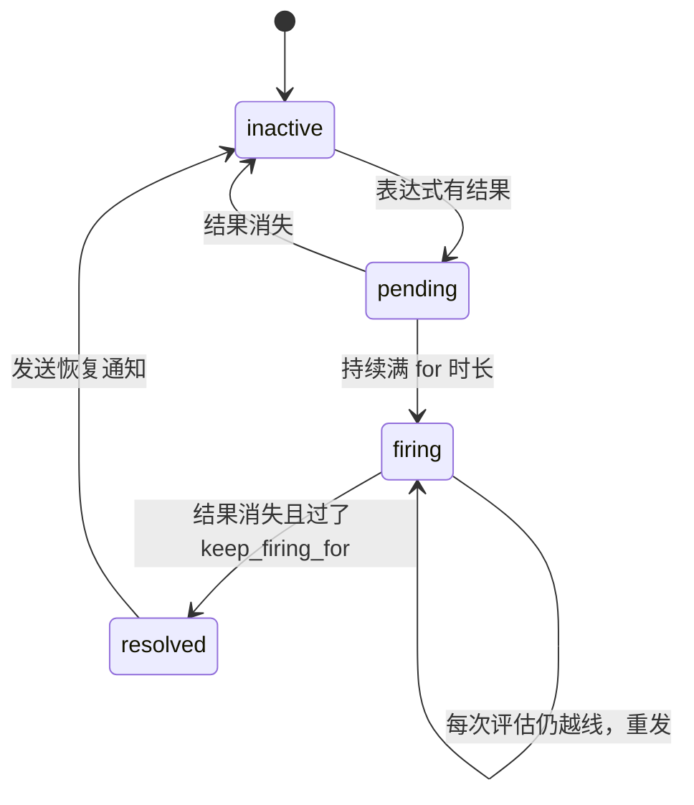

## Q
**告警路径：规则引擎、状态机与 Alertmanager**｜完整答案 · 指标监控（Datadog）

面试官：「规则"5xx 比例 > 5% 持续 5 分钟"从评估到值班人手机响，谁做什么？规则引擎在第 4 分钟重启，`for` 计时会不会归零？Alertmanager 有三台，为什么不会发三次？整条告警链路坏了，谁来告诉你？」

## A
**一句话。** 规则按组用哈希环分给规则引擎实例，每组每 30–60 秒对查询路径执行表达式；每个结果序列有自己的状态机 inactive → pending → firing，状态和开始时间写回时序库（`ALERTS_FOR_STATE`），重启后恢复。firing 的告警每分钟重发给**每一台** Alertmanager，它按标签分组、等待、去重，三台之间用八卦协议同步发送记录和静默，按排位错开发送，所以只发一次；再加一条永远在响的看门狗告警，由外部服务在它停止时报警。

**一条告警的路径。**

**一条规则的状态。**

**步骤。**
1. **分片与评估：** 同组规则按顺序执行（后面可用前面记录规则的结果），按 `hash(租户, 组名)` 归一个实例；表达式作为瞬时查询发给专用查询节点池，评估时间点按组错开，并评估「30 秒前」给迟到数据留余量。
2. **状态机与持久化：** 每条结果序列（如每个 service）一个告警实例：首次出现 pending 并记 `activeAt`，持续满 `for` 进 firing，消失后再等 `keep_firing_for`（可选，防阈值抖动）才 resolved。`activeAt` 写成 `ALERTS_FOR_STATE` 序列，重启或换实例时读它恢复，`for` 不归零。
3. **发给 Alertmanager：** firing 约每分钟重发一次带 `endsAt`，发给每一台，不经负载均衡；规则引擎消失时 `endsAt` 过后自动视为恢复。
4. **分组与抑制：** 按 `group_by`（如 `service, cluster`）归组，新组等 `group_wait`（30 秒）收齐同一事故，有新告警间隔 `group_interval`（5 分钟）更新，内容不变每 `repeat_interval`（4 小时）提醒；静默按标签匹配，抑制规则让「整个集群网络断了」压住同集群的下游告警。
5. **发送与看门狗：** PagerDuty Events API v2 带 `dedup_key`（分组键哈希），同 key 只开一个事件单；Slack 等靠 Alertmanager 自己的发送记录。恒为真的规则（`vector(1)`）永远 firing 并路由到外部「死人开关」，几分钟收不到就从完全独立的渠道打电话。

**故障。**
- **规则引擎实例崩溃：** 哈希环心跳超时后规则组重新分配，新主人从 `ALERTS_FOR_STATE` 恢复；漏一两次评估只让告警晚一点。评估比间隔还慢则这一轮被跳过并计数，对它也要告警，组太大就拆。
- **数据断了、表达式无结果：** 规则会安静地 resolved，是最危险的漏报；关键序列配 `absent()` 无数据告警，摄入延迟本身也告警。
- **整个监控系统挂了：** 看门狗停止，外部死人开关报警；它部署在不同云、不同区域，与主系统不共享依赖。

**为什么这样。**
- 不在 Alertmanager 前放负载均衡：每台都要拿到全部告警才能互相兜底，只发一台则它一挂告警就丢。

