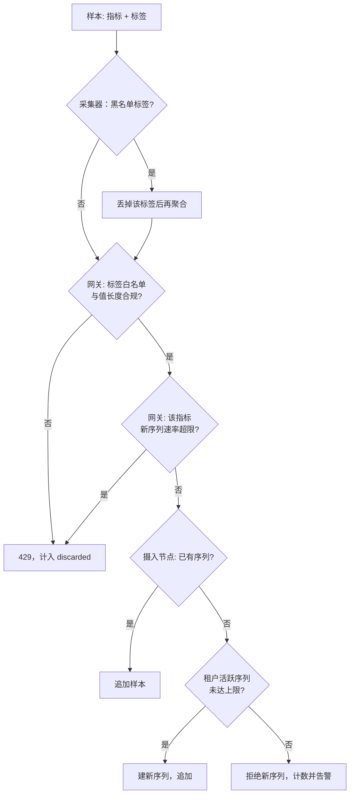

## Q
**基数防护与多租户：三道闸与吵闹邻居**｜完整答案 · 指标监控（Datadog）

面试官：「某团队上线时把 `user_id` 放进了标签，十分钟内新增 3,000 万条序列，摄入节点内存开始告急。系统在哪几层能挡住它？挡的时候谁的数据被丢、别的团队受不受影响、怎么让这个团队知道？」

## A
**一句话。** 三道闸，越靠前越便宜：采集器用改写规则（relabel）丢黑名单标签；网关按租户白名单、标签值长度和「每指标新序列速率」做近似拦截；摄入节点按内存里**精确的**活跃序列数执行租户上限，已有序列照常写，只拒新序列。超限只影响该租户的新序列，返回 429 并计数，平台告警通知该团队；租户之间再用洗牌分片（shuffle sharding）隔离存储与查询。

**一个样本过三道闸。**

**步骤。**
1. **采集器（第一道）：** 平台下发统一配置，`labeldrop` 去掉 `user_id`、`request_id`、`trace_id`、完整 URL 等高基数标签，再按剩余标签合并；在 50 万台上分散完成，中心零成本。
2. **网关（第二道，近似）：** 无状态，查每租户每指标的标签键白名单和长度上限；每（租户，指标）每分钟新序列数用 Redis HyperLogLog（`PFADD` / `PFCOUNT`，约 12 KB、误差 0.81%）估计，只用来发现暴涨。
3. **摄入节点（第三道，精确）：** 它本来就在内存维护每条活跃序列，「是不是新序列」「租户有多少条」都是精确值且几乎零成本：已有序列直接追加，仪表盘和告警不断；新序列到上限就拒。全局上限 G 按节点分摊：本地上限 ≈ G × 副本数 ÷ 摄入节点数。
4. **活跃而非累计：** 序列超过 1 小时没新样本就从头块移除、计数减少，部署换 Pod 名产生的旧序列自然退出，不会慢慢占满上限。
6. **洗牌分片与告警隔离：** 网关按租户 ID 确定性选一小组 Kafka 分区（如 8 个），该租户序列只落对应的摄入节点，查询也只发到它们；一个租户压垮自己那组，只波及少数重叠租户。规则引擎和查询节点是独立池，告警不受仪表盘重查询影响。

**故障。**
- **有人加了 `user_id`：** 网关新序列速率先报警，摄入节点到上限拒新序列，已有仪表盘和告警继续；该团队收到被丢弃的告警和排查清单。
- **上限太紧、合法扩容被挡：** 集群扩容一倍序列数正常翻倍；上限按租户配置可临时调高，并监控距上限比例，到 80% 先预警。

**为什么这样。**
- 不只在网关用 Redis 集合精确计数：5,000 万活跃序列、每秒 500 万样本都查集合，Redis 成了第二个存储；摄入节点本来就知道。
- 不超限就丢租户全部数据：正在用的告警会集体失明；只拒新序列，损失限于多半是坏标签造成的新出现部分。

