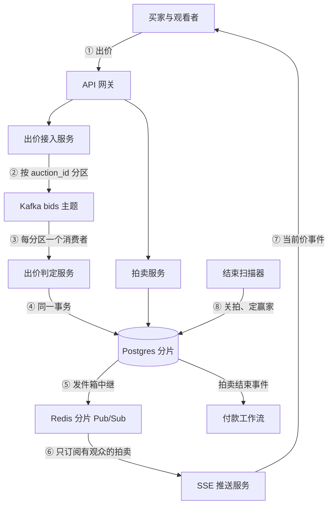

## Q
**全景**｜完整答案 · 在线拍卖（eBay）

面试官：「设计一个类似 eBay 的在线拍卖：卖家发布拍品，买家出价，只有高于当前价的出价被接受，所有人实时看到当前价。同时有 1000 万场拍卖在进行。从需求讲到深挖。」

## A
**一句话。** 每场拍卖的「当前价、领先者、结束时间」放在数据库里拍卖的那一行，出价判定就是对这一行的一次原子更新。出价先写进按 `auction_id` 分区的 Kafka，由每个分区唯一的消费者按序判定，与出价记录、发件箱（outbox）同事务提交；结果经发件箱 → Redis 分片发布订阅 → SSE 推送服务送到观看者；结束由数据库条件 `end_time > 出价时间` 当场生效，扫描任务只负责收尾和启动付款。

**需求。** 发布拍卖、只接受高于当前价的出价、实时看价、结束后确定赢家付款；不做搜索、推荐、物流。出价判定线性一致（不会有两个人同时被告知「你领先」）；已回「已收到」的出价必须最终被判定并留记录；当前价变化约 1 秒到达观看者，显示可略旧，判定永远用最新值；1000 万场同时进行、1 亿观看连接。

**规模。** 每场 7 天、约 100 条出价，高峰按 10 倍：

| 项 | 结果 |
|---|---|
| 出价 | 10⁷ × 100 ÷ 7 天 ÷ 86,400 ≈ 1,650 条/秒，峰值约 1.6 万 |
| 单场热拍卖 | 最后一分钟几千人抢，几百到几千条/秒落在同一行 |
| 观看连接 | 1 亿 ÷ 每台 10 万 ≈ 1,000 台推送服务器 |
| 存储 | 每年 5.2 亿场 ×（1 KB + 100 × 0.5 KB）≈ 26.5 TB，按 `auction_id` 分片 |

总写入量不大，难点是同一行上的争用和海量连接的扇出。

**架构。**

- **出价路径（①–④）：** 接入服务只落 Kafka 回 202，判定只在判定服务里以数据库那一行为准。
- **推送路径（⑤–⑦）：** 数据库提交后才发事件，推送不会领先于事实。
- **结束路径（⑧）：** 关拍是同一行上的又一次条件更新，与出价互斥。

**必讲深挖。**
- **出价路径：** 带 `bid_id` 写 Kafka（`acks=all`），消费者一个事务里插出价、更新拍卖行、写发件箱，提交后才提交位点；重放靠 `bid_id` 主键变空操作。
- **判定与热拍卖：** `SELECT … FOR UPDATE` 锁拍卖行算代理出价；同拍卖同分区串行，热拍卖靠批量判定和「当前价只升不降」的本地拒绝。
- **实时推送：** 中继 `SPUBLISH auction:{id}`，推送服务先订阅再读快照，按 `seq` 去重补洞，每连接只留最新一条。
- **结束与付款：** 出价条件含 `received_at < end_time`；扫描器 `FOR UPDATE SKIP LOCKED` 关拍，付款用持久定时器顺延给次高者。

**为什么这样。**
- 不在 Redis 里判定：与数据库没有事务，任何一步崩溃留下幽灵最高价或丢出价；数据库这一行就能当缓存。
- 不锁 bids 所有行：`FOR UPDATE` 锁不住还没插入的行，第一条出价时一行都锁不到。
- 不让接入服务同步判定：热拍卖最后几秒尖峰压垮数据库连接，Kafka 吸收尖峰并把同拍卖出价排成一队。

