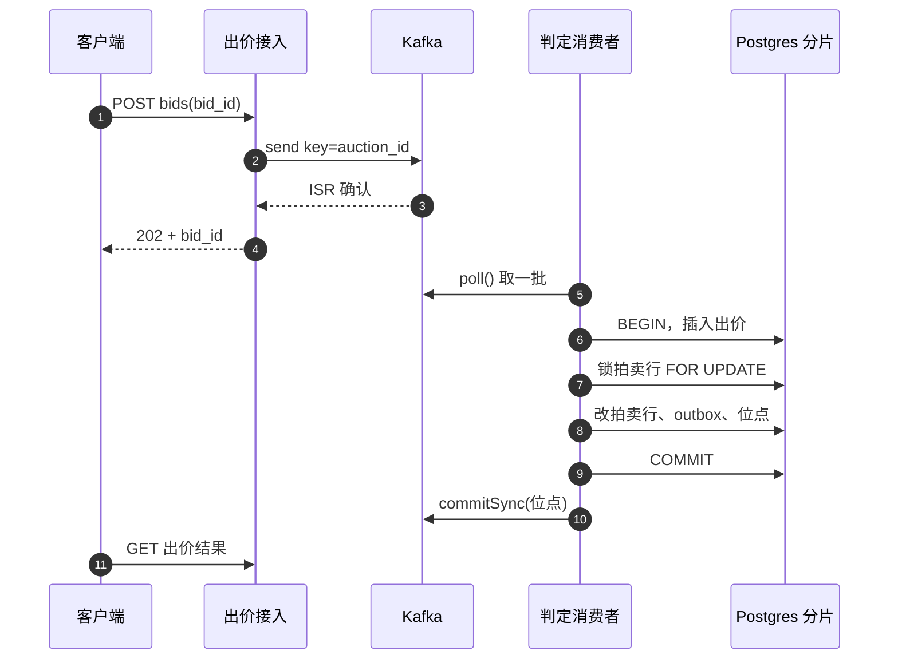

## Q
**出价路径：落 Kafka、判定、提交与不丢**｜完整答案 · 在线拍卖（eBay）

面试官：「一条出价从点下按钮到被判定，经过哪些组件？接入服务回了"已收到"之后，判定服务崩溃、Kafka 重投、数据库主库切换，各会不会丢出价或重复判定？」

## A
**一句话。** 客户端生成 `bid_id` 作幂等键；接入服务以 `auction_id` 为 key、`acks=all` 写 Kafka 后才回 `202`；每个分区只有一个判定消费者，它在**一个数据库事务**里插入出价（`bid_id` 主键）、锁并更新拍卖行、写发件箱、把本分区消费位置也写进同一事务，提交后才算处理完。任何一步崩溃后重放，`bid_id` 已存在就是空操作，既不丢也不重复。

**请求流程。**

**步骤。**
1. **接入与写 Kafka：** 客户端用 UUIDv7 之类生成 `bid_id`，超时重试带同一个；接入服务只做无状态检查（登录、金额、拍卖存在、读缓存早拒）。`acks=all`、`enable.idempotence=true`（Kafka 3.0 起默认），复制因子 3、`min.insync.replicas=2`，同 key 进同分区排成一队。
2. **时间戳：** 主题设 `LogAppendTime`，由 broker 写入时盖章，作为「出价何时到达」的唯一口径，判定和关拍都用它，不用客户端或判定服务的时钟。
3. **回 202：** 收到确认才回，此时出价已收到且不丢但**未判定**，结果由 SSE 推给出价人或 `GET …/bids/{bid_id}` 查询。
4. **消费：** 组协调者把每个分区只分给组里一个成员，同拍卖同一时刻只有一个判定者；关闭自动提交。
5. **一个事务四件事：** `INSERT INTO bids … ON CONFLICT (bid_id) DO NOTHING`（插不进说明处理过，跳过其余）；`SELECT … FROM auctions … FOR UPDATE` 锁行；`UPDATE auctions SET current_price, leader_id, leader_max, seq = seq + 1` 并回填结果；`INSERT INTO outbox` 加 `UPDATE consumer_offsets SET next_offset = :o`。
6. **提交后才告诉 Kafka：** `COMMIT` 后再 `commitSync`，数据库里的位点才是准的，分区重新分配时在 `onPartitionsAssigned` 里读 `next_offset` 并 `seek()`；一次 `poll()` 的几百条按拍卖分组，每组一个事务，一批一次 `commitSync`。

**故障。**
- **写 Kafka 后、回 202 前崩溃：** 客户端重试，同一 `bid_id` 写进两次，判定时第二次 `ON CONFLICT DO NOTHING`。Kafka 写失败（`min.insync.replicas` 不满足）回 503，宁可失败也不假装已收到。
- **`COMMIT` 后、`commitSync` 前崩溃：** 新消费者从库里的 `next_offset` 读，不重处理；即使从旧位点读，`bid_id` 主键也让重放无害。
- **判定服务卡住与僵尸：** 超过 `max.poll.interval.ms`（5 分钟）或 `session.timeout.ms`（45 秒）无心跳就被踢，分区重新分配；被踢的旧消费者可能还在写库，行锁让两者串行，位点写带条件 `WHERE next_offset = :expected`，旧事务条件不满足回滚，起隔离作用。
- **数据库主库切换：** 异步复制可能丢最后几个已提交事务而 Kafka 位点已前进，出价就丢了。解法：同步复制（`synchronous_commit=on` 加至少一个同步备库），或位点只以数据库为准，切换后从库里 `next_offset` 重读。

**为什么这样。**
- 不在接入服务同步写库判定：热拍卖最后几秒几千条/秒打同一行，连接池被行锁占满；规模小没有尖峰时同步条件更新更简单，要说出这个取舍。
- 不只靠 Kafka 位点：位点与数据库是两个系统，中间崩溃必有一侧领先，放进同一事务才原子。

