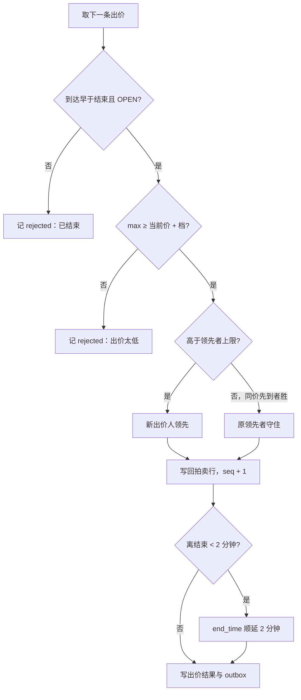

## Q
**判定与热拍卖：一行状态、代理出价与批量判定**｜完整答案 · 在线拍卖（eBay）

面试官：「判定一条出价时，具体比较什么、改哪些字段？要支持代理出价（用户只给一个最高愿付价，系统替他加价）。最后一分钟 3,000 人抢同一件拍品，这一行会不会成为瓶颈？」

## A
**一句话。** 拍卖行存 `current_price`、`leader_id`、`leader_max`（领先者保密的上限）、`seq`、`end_time`；一次判定是「锁这一行 → 算出新领先者与价格 → 写回并插入出价记录」，同一个事务；Kafka 分区已让同一拍卖串行，行锁兜底。热拍卖先用「当前价只升不降」在内存拒掉明显不够的出价，再把一批在内存里逐条判定、一次写回。

**判定流程。**

**判定步骤。**
1. **加锁读行：** `SELECT ... FOR UPDATE`；这一行永远存在，第一条出价也能被挡住。
2. **时间：** 到达时间取 Kafka 的 `LogAppendTime`，须早于 `end_time` 且 `status = 'OPEN'`，所以判定积压过结束时刻也不误判。
3. **最低加价：** 出价上限至少是当前价加一个加价档位，档位随价格分段，存在配置表里。
4. **代理出价：** 新上限 > 领先者上限，新人领先，价 = min(新上限, 旧上限 + 档位)；否则原领先者守住，价 = min(旧上限, 新上限 + 档位)；相等先到者胜。
5. **写回：** `seq + 1`，`leader_max` 永不出现在对外接口和推送里。
6. **防狙击：** 到达时间离 `end_time` 不足 2 分钟（产品参数）就顺延 2 分钟。
7. **发件箱：** 价格或领先者变化时插入 outbox，驱动推送和「你被超过了」。
8. **同步普通出价的单语句版：** `UPDATE ... WHERE status = 'OPEN' AND end_time > now() AND current_price + :inc <= :b`，看受影响行数；Postgres READ COMMITTED 下后到的低价自然 0 行。代理出价分支多，用「锁行加应用层计算」。

**热拍卖（3,000 人抢一行）。** 判定者在内存记着最后写回的当前价，只能用来拒绝、不能用来接受；一次 `poll()` 拿到同一拍卖的几百条出价，锁一次行、内存按序逐条判定，一次写回拍卖行、一次多行 `INSERT`、一行 outbox。结果与逐条判定完全相同，推送也合并成一个最新价事件。

**故障。** 批中崩溃：事务未提交，从位点重做；两个判定者同时处理：行锁串行，`ON CONFLICT` 跳过已处理；关拍任务同样锁行检查 `OPEN`；热拍卖压满分区：移到专用主题；加价档位表带生效时间，按到达时间选规则。

**为什么这样。** 不用 OCC 重试（分区已串行，锁无争用，重试只是浪费）；不用 Redis Lua（与数据库无事务）；不用 SERIALIZABLE（冲突整体回滚重试）；`leader_max` 放拍卖行，判定只读一行。

**数字。** 单行锁行事务几毫秒，逐条约几百次/秒；批量后几千条/秒也只有每秒几十次行更新。
