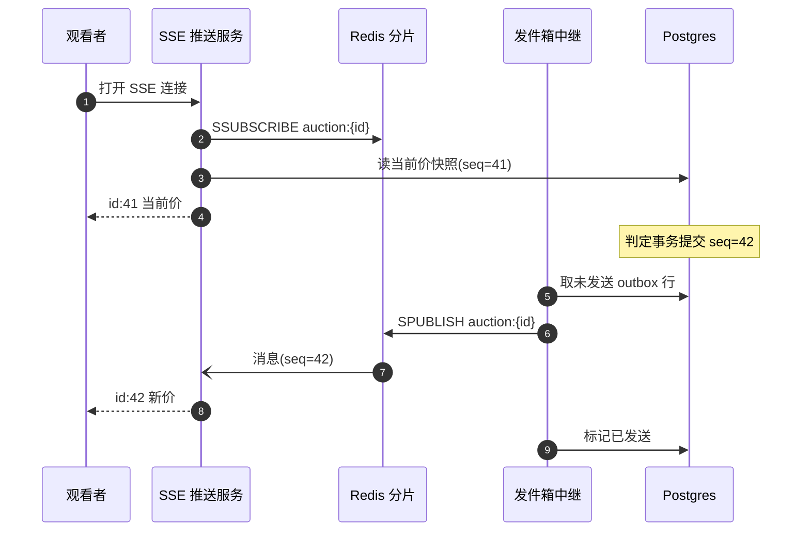

## Q
**实时推送：发件箱、分片 Pub/Sub 与 SSE**｜完整答案 · 在线拍卖（eBay）

面试官：「1 亿个观看连接分散在上千台服务器上。新价判定出来后，谁发布、发到哪、哪台服务器推给哪些连接？推送服务器重启、消息丢了，客户端会不会一直显示旧价？」

## A
**一句话。** 判定事务里写的 outbox 行由发件箱中继在提交后读出，`SPUBLISH auction:{id}` 发到 Redis 集群里该频道所在分片；每台 SSE 推送服务器只对「本机有观众的拍卖」`SSUBSCRIBE`，收到后写给本机这场拍卖的每个连接，每个连接只留最新一条。事件带 `id: seq`：客户端先订阅再读快照，按 `seq` 丢弃旧事件、跳号就主动拉取，重连用 `Last-Event-ID` 补齐，所以推送丢了也会自愈。

**一次推送。**

**步骤。**
1. **建连与先订阅再读快照：** `new EventSource(...)`，响应 `text/event-stream` 并关闭代理缓冲（Nginx `X-Accel-Buffering: no`），否则事件被攒着晚到。推送服务先 `SSUBSCRIBE` 等确认再读当前价作为第一个事件，反过来会漏掉读快照后、订阅前的那次变价；本机内存维护 `auction_id → 连接集合`，最后一个观众离开时 `SUNSUBSCRIBE`。
2. **发件箱中继：** 按分片轮询 `outbox WHERE sent = false ORDER BY id LIMIT 500 FOR UPDATE SKIP LOCKED`，多个实例互不重复；或用 Debezium 读 Postgres WAL 做 CDC，延迟更低；发布成功再标记已发送。
3. **分片发布：** `SPUBLISH` 只在频道哈希槽所在分片内传播，不像 `PUBLISH` 广播整个集群，所以越大越能水平扩展（需 Redis 7.0+ 集群模式）。
4. **写给连接：** 事件放进每连接容量为 1 的「最新值槽」，满了就替换，慢连接只跳过中间价，内存不会无限增长。
5. **客户端与私人结果：** 只接受 `seq` 更大的事件，跳号 2 以上就 `GET /auctions/{id}` 拉最新值；每 15 秒发 `: ping` 防代理断空闲连接；「你被超过了」走用户频道 `user:{id}`，同样经发件箱。

**故障。**
- **推送服务器崩溃或发布：** 连接全断；服务端设 `retry:` 并加随机抖动避免几万客户端同时重连，重连带 `Last-Event-ID: 41`，新服务器见当前 `seq` 更大就补发最新快照。
- **Redis Pub/Sub 丢消息：** 它至多一次，订阅者断线期间的消息直接丢；靠 `seq` 跳号检测、重连补快照和 30 秒一次的兜底拉取自愈。分片切换时订阅断开，重新 `SSUBSCRIBE` 并给本机相关连接补一次快照。
- **超级热门拍卖：** 5 万观众分散在许多服务器，每台只收一条再本地扇出；判定端已按批合并，推送端再按每连接每秒最多一次合并。

**为什么这样。**
- 不让判定服务直接 PUBLISH：先发后提交会推出从未生效的价格，先提交后发布在中间崩溃会漏发；发件箱让「发布什么」成为事务的一部分。
- 不用普通 Pub/Sub 广播：每条复制到每个节点，节点越多越慢。
- 不用 Kafka 直扇出到推送服务：服务器要订阅的是本机有观众的几万个拍卖，Kafka 主题分不了这么细，每台读全量再过滤，流量放大上千倍。

