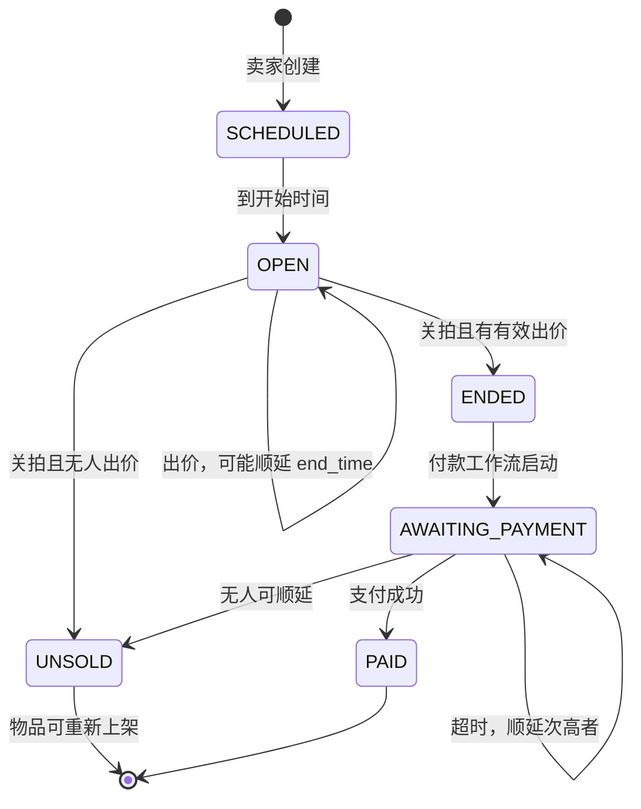

## Q
**结束与付款：关拍、积压中的出价与顺延**｜完整答案 · 在线拍卖（eBay）

面试官：「拍卖 12:00 结束。谁在 12:00 把它关掉？11:59:59 到达、但因为积压 12:00:03 才被判定的出价算不算？赢家 48 小时不付款怎么办？」

## A
**一句话。** 「结束」不靠某个进程准点执行，而靠判定条件：出价只有 Kafka 到达时间早于 `end_time` 才有效，所以 12:00 那一刻就对新出价关闭了。关拍扫描器只做收尾：等该拍卖所在分区的判定进度越过 `end_time`，用 `FOR UPDATE SKIP LOCKED` 领取到期拍卖，条件更新为 ENDED，同一事务记下赢家并写 outbox；付款由以 `auction_id` 为 Id 的工作流负责，持久定时器到期未付就顺延给次高的有效出价人。

**状态机。**

**步骤。**
1. **索引与水位：** 部分索引 `CREATE INDEX ON auctions(end_time) WHERE status = 'OPEN'`；每个判定消费者处理完一批把「本分区已处理到的最大记录时间」写进 `partition_progress`（与位点同事务）；分区没出价时水位不动，所以小任务每秒向每个分区写一条 tick 推进水位。
2. **领取与等积压：** 每片几个扫描器每秒 `SELECT … WHERE status = 'OPEN' AND end_time <= now() ORDER BY end_time LIMIT 200 FOR UPDATE SKIP LOCKED`，各拿不同行、被判定锁着的留下一轮；只关 `partition_progress > end_time + 宽限` 的，宽限几秒吸收 broker 时钟抖动，否则已到达还在排队的有效出价会被关在门外。
3. **关拍事务：** `UPDATE auctions SET status = 'ENDED', winner_id = leader_id, final_price = current_price WHERE status = 'OPEN'`，同事务写 `AuctionEnded`；无领先者设 UNSOLD；中继把它发到推送频道和 `auction-events`。
4. **付款工作流：** 以 `pay-{auction_id}` 为 Workflow Id 启动 Temporal（重复事件只得到同一执行）：通知赢家付款，等「已支付」信号并设 48 小时持久定时器（存服务端，worker 重启不影响）；先到信号则 PAID，先到定时器则标违约、找次高有效出价人发第二次机会并开新定时器。次高者按 `bids` 中 `accepted`/`outbid` 的 `max(amount)` 排除违约者取，按谁的价成交、是否算被拒出价要先和产品确认。

**故障。**
- **扫描器崩溃：** 事务回滚锁释放，下一秒别的实例领走同一行，无需选主或租约；全部宕机几分钟，拍卖照样在 `end_time` 对出价关闭，只是已结束通知和付款晚几分钟，恢复后按 `end_time` 补齐。
- **出价与关拍同时到：** 锁同一行，判定检查 `status = 'OPEN'` 和到达时间，关拍检查 `status = 'OPEN'`，串行后结果唯一。
- **重复与迟到：** `AuctionEnded` 靠 Workflow Id 去重，条件更新使重复成空操作；支付幂等键 `auction_id + user_id`，顺延给别人后迟到的付款要退款，规则里要写明。

**为什么这样。**
- 不给每场拍卖设精确定时器：1000 万个定时器加每次防狙击取消重设，定时器晚触发还会多开几秒；判定条件让结束当场生效。
- 不用 Redis 有序集合当延迟队列：它与数据库是两份状态，顺延要同步改两处，`end_time` 本来就在数据库那一行。
- 不用 cron 扫全表：没有部分索引和 `SKIP LOCKED` 时多实例重复或互相阻塞，单实例又是单点。

