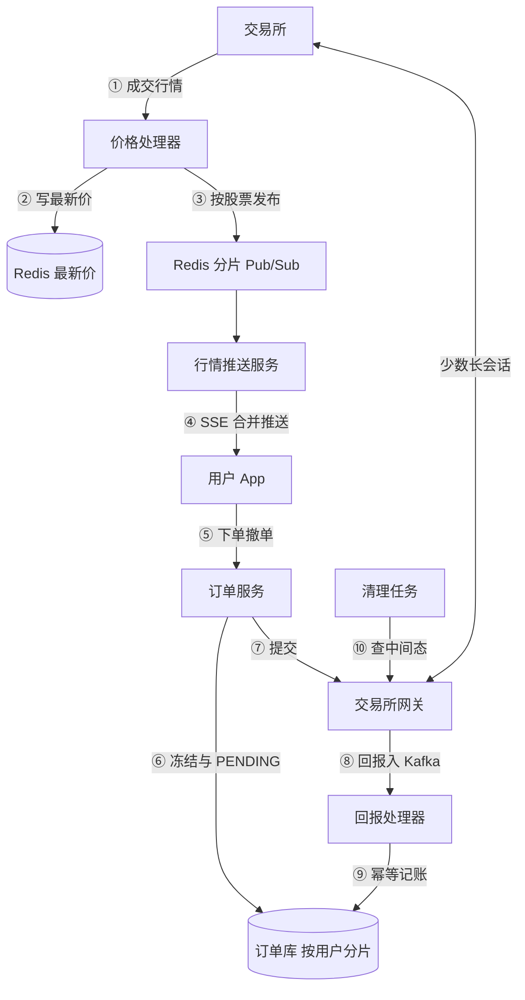

## Q
**全景**｜完整答案 · 股票交易（Robinhood）

面试官：「设计一个类似 Robinhood 的券商 App：用户看实时股价，下市价单和限价单，能撤单，能查看自己的订单。2000 万日活，每人每天约 5 笔。从需求讲到深挖。」

## A
**一句话。** 我们是券商不是交易所。行情是「一路进、几百万路出」的广播：价格处理器 → Redis 按股票分频道发布订阅 → SSE 推送服务，只发最新价。订单是我们的库和交易所这两个不共享事务的系统之间的协议：先在用户所在分片一个事务里冻结资金、写 `PENDING` 订单和我们生成的 `clientOrderId`，再经少数几条交易所会话提交；成交回报按 `execId` 幂等记账；卡在中间态的订单由清理任务凭 `clientOrderId` 向交易所查询，收敛到终态。

**需求。** 看实时股价（多只）、市价单和限价单、撤单、分页看订单并实时看到成交；不做盘前盘后、期权、加密、盘口、多交易所路由。订单强一致：不重复下单、不丢成交、资金不超额占用，状态不明宁可拒单（fail closed）；行情可用优先，可晚几百毫秒、丢中间值但不能断流；行情和回执 200 ms 内；交易所连接很贵，全公司只开少数几条。

**规模。** 交易时段 23,400 秒，尖峰为平均 10 倍，同时在线 10%，每人自选 10 只、热门股每秒约 50 次变价：

| 项 | 结果 |
|---|---|
| 订单 | 2000 万 × 5 ÷ 23,400 ≈ 4,300 笔/秒，尖峰约 4 万 |
| 成交回报 | 约为订单量的 2–3 倍 |
| SSE 连接 | 2000 万 × 10% ÷ 每台 5 万 = 40 台，加余量 50–60 台 |
| 推送出口 | 200 万 × 每连接每秒最多 5 个合并事件 ≈ 1000 万事件/秒 |
| 订单存储 | 每天 1 亿笔 × 约 0.5 KB × 252 天 ≈ 12.6 TB/年 |

**架构。**

- **行情路径（①–④）：** 交易所只被价格处理器连一次，推送服务只订阅本机用户在看的股票。
- **下单路径（⑤–⑦）：** 先在库里留意图和冻结，再做不可撤回的外部动作。
- **回报路径（⑧–⑨）：** 网关把回报持久化进 Kafka 就算收到，回报处理器在用户分片上一个事务记订单、持仓、现金。

**必讲深挖。**
- **下单：** 一个事务写幂等键、条件更新冻结资金、插 `PENDING`；提交后才改 `OPEN`；超时不等于失败，留在 `PENDING` 等清理任务查。
- **成交与撤单：** 回报按 `exec_id` 去重，订单、持仓、现金同事务；撤单只改 `PENDING_CANCEL`，冻结等交易所最终回报才释放。
- **行情：** 每支股票一个 Redis 频道，每台推送服务每股只订阅一次，每连接只留最新价，每 200 ms 最多一个事件。
- **清理与对账：** 凭 `clientOrderId` 查交易所，查无此单且已过提交截止时间才判失败；日终逐笔核对成交。

**为什么这样。**
- 不让 App 直连交易所：连接数爆炸，订单只记在手机上，丢了无从查起。
- 不用分布式事务：交易所不参与我们的两阶段提交，能用的只有可查询的唯一号、条件更新和对账。

