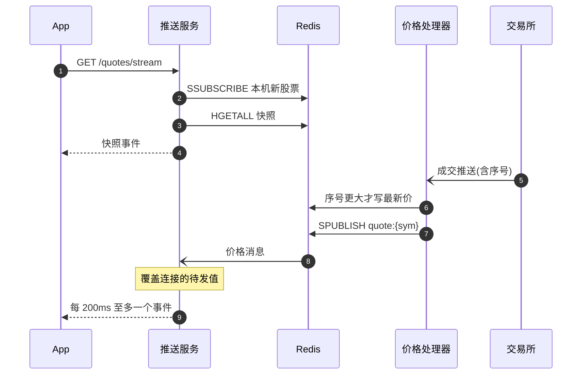

## Q
**行情路径：一路进、两百万路出**｜完整答案 · 股票交易（Robinhood）

面试官：「200 万人同时开着 App，每人盯着 10 只股票。交易所一笔成交，到用户屏幕上的价格变化，中间经过哪些组件？热门股每秒变价几十上百次，怎么不把手机和服务器压垮？推送服务器重启时，用户会不会一直看到旧价？」

## A
**一句话。** 价格处理器是唯一连交易所行情的组件，把每支股票最新价连同序号写进 Redis，再 `SPUBLISH quote:{AAPL}`；每台推送服务只对「本机有人在看」的股票 `SSUBSCRIBE`，收到后覆盖每个连接的「待发最新价」，每连接每 200 ms 最多发一个 SSE 事件，含这段时间所有变过的股票。新连接和重连都先订阅再读 Redis 快照，所以丢掉的推送只让价格晚一拍，不会一直错。

**一次价格变化。**

**步骤。**
1. **先订阅再读快照：** `GET /quotes/stream?symbols=…`，响应 `text/event-stream` 并关代理缓冲；内存维护 `symbol → 连接集合`，本机第一次有人看 AAPL 才 `SSUBSCRIBE quote:{AAPL}`；确认后 `HGETALL quote:{AAPL}` 读价格、`seq`、时间并作为第一个事件发出。顺序反过来会漏掉读快照后、订阅前的那次变价。
2. **行情进入：** 价格处理器连交易所行情，每条带交易所序号，按股票分片，一支股票只归一个实例所以天然有序；用 Lua 比较序号，只有新序号更大才 `HSET`，主备切换时重复或迟到的旧行情写不进去。
3. **发布：** `SPUBLISH quote:{AAPL}` 带价格和序号，频道名与快照键共用哈希标签 `{AAPL}` 落在同一分片，分片发布订阅只在该分片内传播，不像 `PUBLISH` 广播整个集群；投递给订阅的推送服务最多几十台，与用户数无关。
4. **合并与节流：** 推送服务不逐条转发，对每个连接把待发值覆盖成最新价并标脏；连接空闲时第一次变化立刻发并开 200 ms 窗口，窗口内只覆盖，结束时把变过的股票打成一个事件 `{"AAPL":18012,"META":51230}`；App 按序号丢弃比本地旧的值。

**故障。**
- **推送服务宕机：** `EventSource` 自动重连，自写客户端按 1–5 秒加抖动，避免 5 万连接同时涌向别台；新服务器重走订阅加快照，最多晚一个重连间隔。
- **Redis 分片故障转移：** 发布订阅不存消息，切换期间价格丢失；重新 `SSUBSCRIBE` 后对这些股票重读快照推给连接。
- **价格处理器宕机：** 每分片一主一备，备机同样收行情，主租约过期后接手，重复写被序号挡掉；交易所行情跳号则用补发或快照接口恢复，补齐前照常发最新价。

**为什么这样。**
- 不用 Kafka 推给推送服务：每台都需要任意股票的更新，就得消费所有分区，退化成全量广播。
- 不逐条转发：每连接每秒 500 条用户肉眼看不出区别却耗电耗流量；行情是状态，丢中间值无损，订单成交是事件，不能合并。

