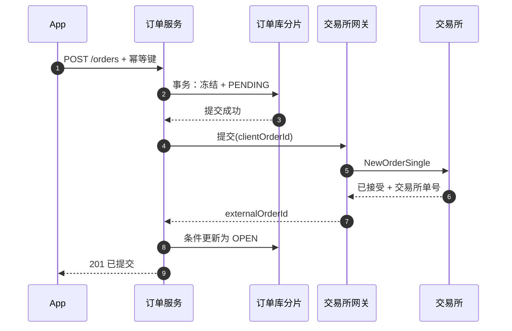

## Q
**下单路径：先冻结、先留痕，再提交**｜完整答案 · 股票交易（Robinhood）

面试官：「用户点"买入 10 股 AAPL，限价 180 美元"。请求从 App 到交易所再回来，经过哪些组件、按什么顺序写什么？两个人同时用同一笔钱下单怎么办？App 超时重试会不会下两笔？订单服务在提交之后崩溃呢？」

## A
**一句话。** 订单服务在用户所在分片开一个事务：插幂等键、条件更新冻结 1,800 美元、插 `PENDING` 订单（带我们生成的 `clientOrderId` 和提交截止时间），提交后才经交易所网关发新订单；交易所接受并返回订单号，再条件更新 `PENDING → OPEN`。任何一步超时都不当作失败：订单留在 `PENDING`、钱留在冻结里，由清理任务凭 `clientOrderId` 去查。

**请求流程。**

**步骤。**
1. **幂等键与路由：** JWT 得 `user_id` 并定位分片，订单、持仓、现金同分片，下单只涉及一个分片。事务第一句 `INSERT INTO idem_keys … ON CONFLICT DO NOTHING`，0 行是重试：请求体哈希相同返回第一次的订单，不同返回 422。
2. **冻结资金：** 需要 180 × 10 = 180,000 分，`UPDATE accounts SET reserved_cents = reserved_cents + 180000 WHERE user_id = :u AND cash_cents - reserved_cents >= 180000`，0 行回滚并拒单；卖单对应冻 `reserved_qty`。市价单没有限价，按最新卖价上浮缓冲（如 5%）冻结，成交后按实际结算退差额。
3. **插订单并提交：** `status='PENDING'`、`submit_deadline = now() + 3s`，追加一行 `order_events`。`client_order_id` 带分片前缀（如 `s07-<order_id>`），回报原样带回，不用查映射就能找到分片。提交后即使马上崩溃，库里也有可查询的痕迹。
4. **发给网关并接受：** 网关持少数几条长会话，FIX 新订单是 `NewOrderSingle`（`35=D`），`ClOrdID`（tag 11）即 `client_order_id`；网关先检查 `now() < submit_deadline`，过期拒发。交易所回 `ExecutionReport`（`35=8`，`ExecType=New`）带订单号 `OrderID`（tag 37）。
5. **改 OPEN：** `UPDATE orders SET status='OPEN', external_order_id=:x WHERE order_id=:o AND status='PENDING'`；若成交回报抢先把订单推到部分成交，这步影响 0 行，不会把状态改回去。回 `201 {orderId, status: OPEN}`，正常几十毫秒。

**故障。**
- **两笔订单同时用同一笔钱：** 条件更新的行锁让它们排队，后到者重算 WHERE 时余额不够影响 0 行被拒，不用先 `SELECT` 余额。
- **App 超时重试：** 同一 `Idempotency-Key` 冲突，返回第一次的订单，进行中就返回 `PENDING`，绝不再下一笔。
- **提交后、发给网关前崩溃：** 订单停在 `PENDING`，交易所没见过；清理任务过 `submit_deadline` 查无此单，标 `REJECTED` 释放冻结，网关拒发过期订单所以它不会再冒出来。
- **发出后、写 OPEN 前崩溃：** 交易所有单、库里 `PENDING`；清理任务用 `OrderStatusRequest`（`35=H`）按 `ClOrdID` 查到并补写；期间的成交回报照常记账，因为状态机允许 `PENDING` 直接成交。
- **网关调用超时：** 不释放冻结、不重发，告诉用户「提交中」，等回报或清理结论。交易所拒单则一个事务里改 `REJECTED`、释放冻结。
- **会话断开：** 网关重连，FIX 每条消息带 `MsgSeqNum`（tag 34），按序号 `ResendRequest` 补发，断线回报不丢。分片主库不可用则这些用户下单回 503，没有持久的 `PENDING` 就不提交。

**为什么这样。**
- 不先提交再写库：提交后崩溃，交易所有一笔我们不知道的订单，用户看不到也撤不了。
- 不先查余额再扣：查和扣之间有空隙，并发会超额，条件更新合成一步。

