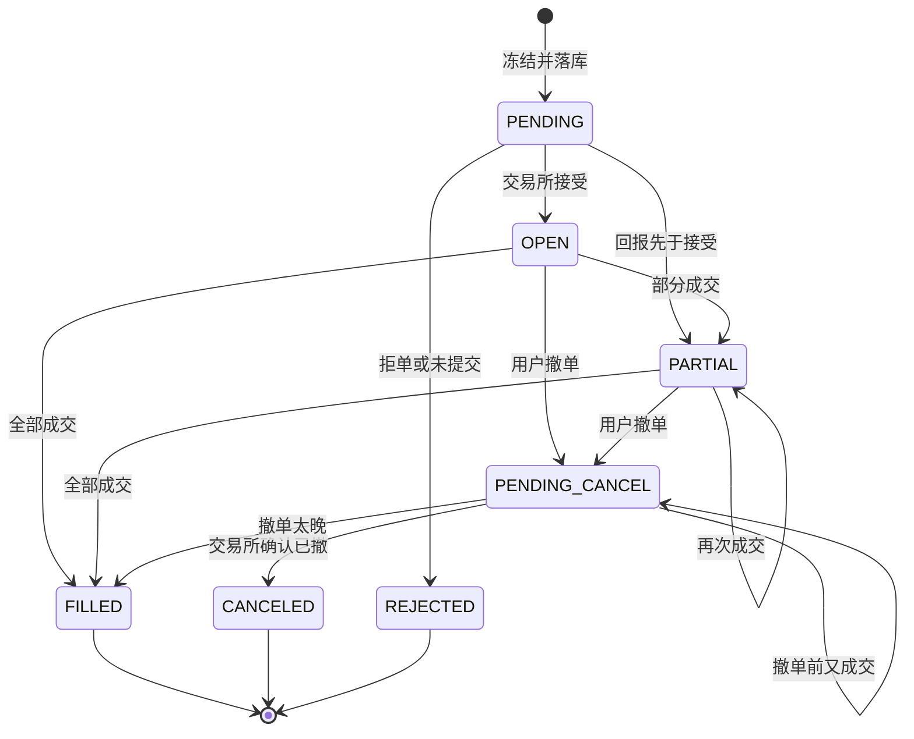

## Q
**成交回写与撤单：状态机只听交易所的**｜完整答案 · 股票交易（Robinhood）

面试官：「限价单挂在交易所上，先成交 3 股，再成交 7 股。成交回报怎么找到订单、怎么记账？用户中途点撤单，交易所恰好在同一时刻成交了，最后状态由谁说了算？冻结的钱什么时候退？」

## A
**一句话。** 网关把每条执行报告先写进按分片分区的 Kafka，回报处理器在用户分片一个事务处理一条成交：`exec_id` 主键去重、订单累计成交、持仓与现金结算、按比例释放冻结、追加事件和发件箱。撤单只把状态改成 `PENDING_CANCEL` 并发撤单请求；交易所是唯一仲裁者，回「已撤」才释放剩余冻结，回「太晚，已成交」就按成交记账。终态（`FILLED`、`CANCELED`、`REJECTED`）只进不出。

**订单状态机。**

**成交步骤。**
1. **网关持久化：** 执行报告（`35=8`，`ExecType=Trade`）含 `ExecID`（tag 17 每笔唯一）、`ClOrdID`、`LastQty`、`LastPx`、`CumQty`、`LeavesQty`；网关从 `ClOrdID` 前缀解析分片号，以它为键写 Kafka（`acks=all`）后才记「已处理到会话序号 N」，重启从 N 之后补发。
2. **事务：** 每个分区一个消费者按序处理。`INSERT INTO executions … ON CONFLICT (exec_id) DO NOTHING`，0 行即重复，跳过；`UPDATE orders SET filled_qty = filled_qty + :q, status = CASE …` 条件含 `status IN ('PENDING','OPEN','PARTIAL','PENDING_CANCEL')`，终态不在内，迟到回报改不动终态。
3. **结算（买单）：** 3 股成交在 179.50 美元，`cash_cents -= 53850`，`reserved_cents -= 54000`，`positions.qty += 3`，150 分差额回到可用余额；卖单对称。追加 `order_events` 和 outbox；先提交事务再提交 Kafka 位点，中间崩溃只会重放，被去重挡住。
4. **推给用户：** outbox 中继发布到 `orders:{user_id}`，推送只是提示，重连时以 `GET /orders` 为准。

**撤单步骤。**
1. **标记与发出：** `UPDATE orders SET status='PENDING_CANCEL' WHERE … AND status IN ('OPEN','PARTIAL')`，0 行就返回当前状态，重复点击是空操作，冻结**不动**；网关发 `OrderCancelRequest`（`35=F`）带新 `ClOrdID` 和 `OrigClOrdID`（tag 41），立刻回 `202`。
2. **结果：** `ExecType=Canceled` 则一个事务里改 `CANCELED` 并释放剩余冻结（剩余股数 × 限价）；`OrderCancelReject`（`35=9`，通常已全部成交）则不改状态，等成交回报推到 `FILLED`，只有交易所报告仍在挂单才把 `PENDING_CANCEL` 改回 `OPEN` 或 `PARTIAL`。

**故障。**
- **撤单与成交同时发生：** 交易所对同一订单串行，结果只有先成交后撤（退剩余冻结）或来不及撤（撤单被拒加成交回报）；我们只按回报推进状态机，不自己猜。
- **重复与乱序回报：** 断线补发可能重发（`PossDupFlag`，tag 43），`exec_id` 主键使其空操作；回报先于「已接受」时状态机允许 `PENDING → PARTIAL` 并写上 `external_order_id`，迟到的「已接受」影响 0 行。

**为什么这样。**
- 不在点撤单时就退钱：撤单在路上时订单仍可能成交，先退再成交就花掉不存在的钱。
- 不分多个事务更新订单、持仓、现金：中间失败会有股票没扣钱，三者同分片一个本地事务够了。
- 不「读状态、程序判断、再写回」：撤单接口和回报处理器并发会互相覆盖，条件更新让数据库决定谁先到。
- 不靠全局映射找订单：`ClOrdID` 带分片前缀，回报自带路由。网关也不直接写库，它要尽快读会话，写 Kafka 是顺序追加且已按分片排好。

