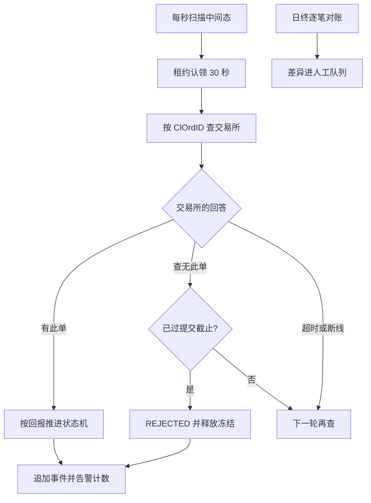

## Q
**清理任务与对账：让中间态一定收敛**｜完整答案 · 股票交易（Robinhood）

面试官：「订单服务在提交之后、写库之前崩溃；或者网关和交易所断开了几秒。你怎么保证每笔订单最终和交易所一致、冻结的钱不会被永远占着？"查无此单"能不能直接判失败？日终对账又在对什么？」

## A
**一句话。** 每个分片有一个清理任务，每秒扫一次超过 5 秒还停在 `PENDING` 或 `PENDING_CANCEL` 的订单，租约认领后凭 `clientOrderId` 向交易所查询，结果交给与成交回报**同一套**状态机代码推进；只有提交截止时间已过、网关保证不会再发之后，「查无此单」才能判为未提交并释放冻结。日终再拿当天全部成交与交易所、清算机构的记录逐笔核对，差异进人工队列，以交易所为准。

**清理流程。**

**步骤。**
1. **找候选与租约认领：** `SELECT … WHERE status IN ('PENDING','PENDING_CANCEL') AND updated_at < now() - interval '5 seconds' AND (sweep_until IS NULL OR sweep_until < now()) LIMIT 200`，`(status, updated_at)` 上建部分索引，表再大也只碰极少行；`UPDATE … SET sweep_until = now() + interval '30 seconds'` 返回 1 行才归我，不用长事务锁着行去调交易所。
2. **查询：** 网关发 `OrderStatusRequest`（`35=H`）带 `ClOrdID`，交易所用 `ExecType=Order Status` 的报告回答；各交易所格式不同，网关统一翻译成「有此单 / 查无此单 / 不确定」。
3. **有此单：** 当作普通回报交给回报处理器同一段代码，补 `external_order_id`、按 `CumQty` 推进，缺的成交明细补齐并按 `exec_id` 去重。
4. **查无此单：** 已过 `submit_deadline`（网关发单前检查，过期拒发）就证明永远不会出现，一个事务里改 `REJECTED`（未提交）、释放冻结、推送「下单失败，资金已退回」；未过截止则请求可能还在路上，下一轮再查。不自动重提，尤其市价单几秒后价格已变，由用户决定。
5. **`PENDING_CANCEL` 卡住：** 交易所说仍在挂单就再发一次撤单（重复撤单只会被拒），说已撤或已成交就按回报推进。
6. **日终对账：** 收盘后把 `executions` 与交易所成交报告、清算记录按成交号逐笔比对，缺的、多的、数量或价格不同的进人工修复队列，修复只追加调整记录；每个账户「开盘持仓 + 当日成交 = 收盘持仓」并与托管记录核对。

**故障。**
- **清理任务崩溃：** 租约 30 秒后过期别的实例接手，只做查询和条件更新，重做无害；与回报处理器同时推进同一订单，都用带状态条件的更新、成交按 `exec_id` 去重，谁先谁后结果一样。
- **交易所整体不可用：** 查询退避重试，订单停在 `PENDING`、钱留在冻结里，保守而正确；网关会话全断时订单服务直接拒单（fail closed），不继续堆更多中间态。
- **回报流丢了一段：** 盘中每 10 分钟抽查「各会话最后处理的序号」与已开订单的交易所状态，不等到日终。

**为什么这样。**
- 不见到「查无此单」就判失败：请求可能还在网络里，退钱后订单又在交易所成交，钱就不够了；截止时间加网关拒发才让它成为确定结论。

