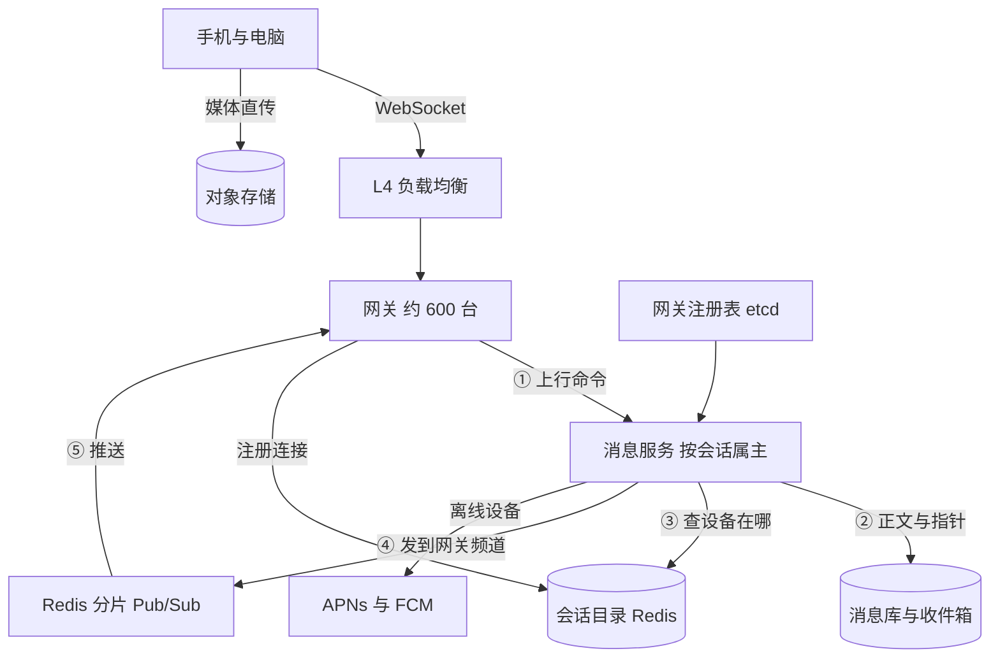

## Q
**全景**｜完整答案 · 即时通讯（WhatsApp）

面试官：「设计一个类似 WhatsApp 的即时通讯：一对一和最多 100 人的群聊，收发文字和图片，离线 30 天内上线能补收，一个人可以有手机和几台电脑。3 亿日活，每天约 100 亿条消息。从需求讲到深挖。」

## A
**一句话。** 客户端与网关之间是长期 WebSocket；消息服务按 `chatId` 把每个会话交给唯一属主实例，属主按（`chatId`，`clientMsgId`）去重、分配会话内递增 `seq`、先把正文写进消息库并给每个收件人的每台设备写一条收件箱指针，然后才回「已发送」；再查会话目录找到设备所在网关，`SPUBLISH` 到该网关专属频道，网关推给设备，设备 ack 后删指针。推送尽力而为，丢了靠收件箱和 `seq` 空洞检测补齐；离线设备用系统推送唤醒，上线后按游标同步。

**需求。** 一对一与 ≤100 人群、文字与媒体、离线 30 天内补收、多设备（上限如 5 台）、已发送与已送达回执；不做通话、万人群、搜索。回了「已发送」的消息 30 天内一定送到每台设备、不丢不重复显示；会话内顺序一致，会话间不要求；双方在线 500 ms 内；任何一台网关、Redis 分片、消息服务实例挂掉只影响几秒延迟。

**规模。** 峰值为平均 3 倍，峰值在线 4500 万，每条约 1 KB，平均投递约 3 台设备：

| 项 | 结果 |
|---|---|
| 消息 | 100 亿 ÷ 86,400 ≈ 11.6 万条/秒，峰值约 35 万 |
| 收件箱写 | 35 万 × 3 ≈ 100 万指针/秒，ack 后删同样多 |
| 新增存储 | 约 10 TB/天，30 天约 300 TB；保留 5 年约 18 PB，只能分层放对象存储 |
| 网关 | 4500 万 ÷ 每台 10 万 = 450 台，加余量约 600 |
| 心跳 | 4500 万 ÷ 30 秒 ≈ 150 万 ping/秒，全在网关内处理 |

**架构。**

- **发送（①–②）：** 先持久化再回「已发送」，之后任何故障都不丢。
- **投递（③–⑤）：** 频道数等于网关数而非用户数，Pub/Sub 至多一次只负责快。
- **离线与媒体：** 系统推送只唤醒 App，内容上线后同步；媒体字节不经聊天服务器。

**必讲深挖。**
- **发送：** 去重 → 分配 `seq` → 写正文与每台设备指针 → 回「已发送」→ 推送，顺序不能反。
- **路由：** 会话目录记设备在哪台网关，`SPUBLISH gw:{id}`；网关死了由注册表租约发现。
- **离线与多设备：** 每设备一条指针各自 ack，重连按游标分页同步，回执按会话累计「读到哪个 `seq`」。
- **连接故障：** 应用层心跳发现假连接，重连带抖动，发布时排水分批断开。

**为什么这样。**
- 不先推送再落库：推送成功写库失败，发件人以为已送达，其他设备永远收不到。
- 不每用户一个 Kafka 主题：数亿主题撑不住；也不每在线用户一个频道，4500 万个频道加每次上下线订阅退订，按网关一个只有约 600 个。
- 不用服务器时间戳排序：多机时钟有偏差，回复可能排在问题前面；`seq` 由唯一属主分配。

