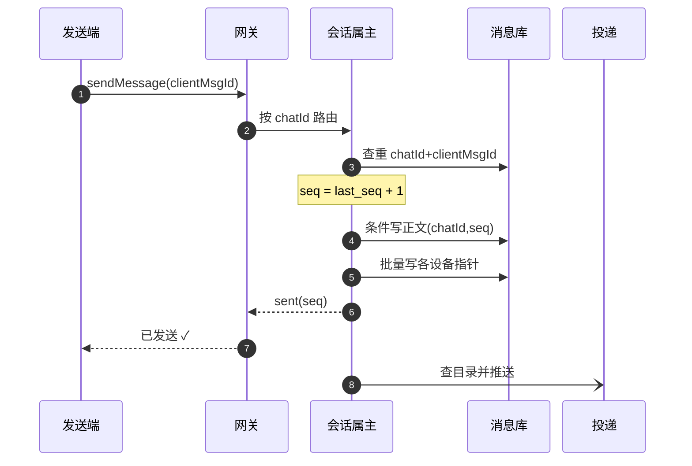

## Q
**发送路径：去重、会话内序号、先落库再推送**｜完整答案 · 即时通讯（WhatsApp）

面试官：「用户在电梯里发出一条消息，信号断断续续，App 重发了三次。服务端按什么顺序做什么，才能保证这条消息只出现一次、在所有人的屏幕上排在同一个位置、回了"已发送"就一定送达？负责这个会话的服务实例挂了呢？」

## A
**一句话。** 每个会话任一时刻只有一个属主实例（按 `chatId` 一致性哈希，资格由 etcd 租约和递增纪元号 `epoch` 保证）；属主收到 `sendMessage` 先按（`chatId`，`clientMsgId`）查重，新消息在内存里取 `seq = last_seq + 1`，以「`(chatId, seq)` 不存在」为条件写正文，再批量写收件箱指针，全部成功才回 `sent{seq}`，最后才推送。重发命中去重记录得到同一个 `seq`；属主切换时新属主从库读最大 `seq` 接着发，旧属主迟到的写因条件冲突失败。

**一条消息。**

**步骤。**
1. **客户端与路由：** 点发送时生成 `clientMsgId`（UUID），本地先显示「发送中」并进待发队列，没收到 `sent` 就退避重发、每次同一个 ID；网关用 etcd 成员表的一致性哈希环算出属主转发，非属主回重定向。
2. **查重与分配序号：** 先查本地近期缓存，再查 `dedup(chatId, clientMsgId) → seq`（24 小时 TTL），命中直接回原 `seq`；否则内存里的 `last_seq` 加一，同会话在属主内串行，不需要分布式计数器。
3. **条件写正文：** 写 Message 主键 `(chatId, seq)` 和去重记录，条件「这个 `seq` 不存在」（Cassandra `INSERT … IF NOT EXISTS`，DynamoDB `attribute_not_exists` 事务写）。
4. **写指针并回 sent：** 展开成每个成员的每台设备（含发送者自己的其他设备），批量写 `Inbox(device_id, chat_id, seq)`，键确定所以重写无害；正文和全部指针都成功才回 `sent{clientMsgId, seq}`，App 换成带 `seq` 的正式消息。投递异步，失败不影响任何保证。

**故障。**
- **重发（`sent` 丢了）：** 查重命中回同一 `seq`，不写第二份。
- **写完正文、写指针时属主崩溃：** 发送端没收到 `sent` 会重发，新属主查重命中但不知指针是否写全，所以对已存在的消息**重放写指针**再回 `sent`，幂等所以无害。
- **属主切换：** 旧租约过期、环更新，新属主读 `max(seq)` 作 `last_seq`，纪元加一；旧属主只是卡顿时，醒来后的写用的 `seq` 已被占用，条件失败，它就知道自己不再是属主。
- **`seq` 空洞：** 分配 42 后写入前崩溃，42 永不存在；客户端发现空洞去拉，看到 43 存在、42 查无就当作已确认的空洞，不再等。

**为什么这样。**
- 不用 Redis `INCR` 分配序号：计数器加一和消息写入不是一个原子操作，一次主从切换就可能发出重复序号；属主内存计数加库里条件写，重复会被库挡下。
- 不用 Kafka 按 `chatId` 分区当日志：每个分区挂成千上万个会话，一个慢会话拖住同分区所有会话，`seq` 也要另映射。

**数字。** 峰值 35 万条/秒正文加约 100 万条/秒指针（几十字节，按 `device_id` 分区均匀）；去重只存 `(chatId, clientMsgId) → seq`，可并进 Message 表的二级键；网关转发、查重、两次写库各几毫秒，「已发送」通常几十毫秒内回到发送端。
