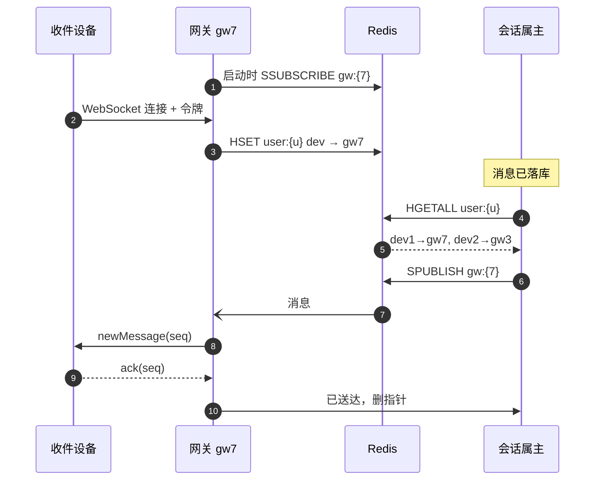

## Q
**路由与在线投递：消息怎样找到收件人的那条连接**｜完整答案 · 即时通讯（WhatsApp）

面试官：「4500 万条 WebSocket 连接分散在 600 台网关上。消息写进库之后，怎么知道收件人的手机和电脑分别连在哪台网关、怎么送过去？网关突然宕机、或者手机进了地铁连接已经不通但服务器不知道，会怎样？」

## A
**一句话。** 设备连上网关后，网关把 `device_id → gateway_id` 写进 Redis 会话目录；每台网关只订阅一个属于自己的频道 `gw:{id}`。属主写完库后查目录，按网关把收件设备分组，每组 `SPUBLISH gw:{id}` 一次，网关查本机 `device_id → 连接` 推送并等 ack。网关是否活着不靠目录条目的 TTL，而靠 etcd 里网关自己的租约，租约没了目录里指向它的条目一律当离线；连接是否真的通，靠应用层心跳。

**一次在线投递。**

**步骤。**
1. **网关上线与设备登记：** 在 etcd 用带租约的键注册（约 10 秒，后台续），再 `SSUBSCRIBE gw:{7}`，哈希标签使它落在某个分片内传播；设备连接由 L4 按最少连接分配，网关校验令牌记 `device_id → 连接`，并 `HSET user:{u} {dev} gw7`，整键设较长过期（如 1 天）只为清理长期不用的用户，不靠它判断在线。
2. **查目录并过滤死网关：** 属主批量 `HGETALL` 得每台设备所在网关；缓存 etcd 网关名单，指向不在名单上的网关的按离线处理并顺手删条目。
3. **按网关分组发布：** 100 人的群可能分布在几十台网关，每台只 `SPUBLISH` 一次，消息里列出本机要投递的设备；网关逐个写 `newMessage`，设备已不在本机就丢弃，收件箱会补。
4. **ack 与离线：** 设备回 `ack{chatId, seq}`，网关攒批交给消息服务删指针并生成「已送达」回执；离线或网关已死的设备走 APNs / FCM 系统推送唤醒，不放正文，App 醒来自己同步。

**连接故障。**
- **假连接：** 客户端每 30 秒 `ping`，网关 2 个周期（约 60 秒）收不到帧就关连接删目录条目；推送后 2 秒没收到 ack 重发一次，再无回应就断开让客户端重连后从收件箱同步。
- **网关宕机：** etcd 租约约 10 秒后过期，属主不再往它发；它的 7.5 万连接（4500 万 ÷ 600）同时断开，客户端 0–30 秒随机抖动重连到别台、重新登记并同步收件箱，宕机期间的消息都在收件箱里不丢。
- **重连风暴与发布：** 网关对新连接限速，超出让客户端按服务端给的时间重试，同步分页并限制每连接并发查询；发布时先摘出负载均衡，再分批发关闭帧 1001，每批几千条间隔几秒。

**为什么这样。**
- 不每用户一个频道：4500 万个频道、每次上下线都订阅退订；每网关一个只有约 600 个，多设备也自然支持。
- 不给目录条目设短 TTL 靠心跳续：4500 万条每 30 秒续一次就是每秒 150 万次 Redis 写，按网关一个租约只有 600 个。

