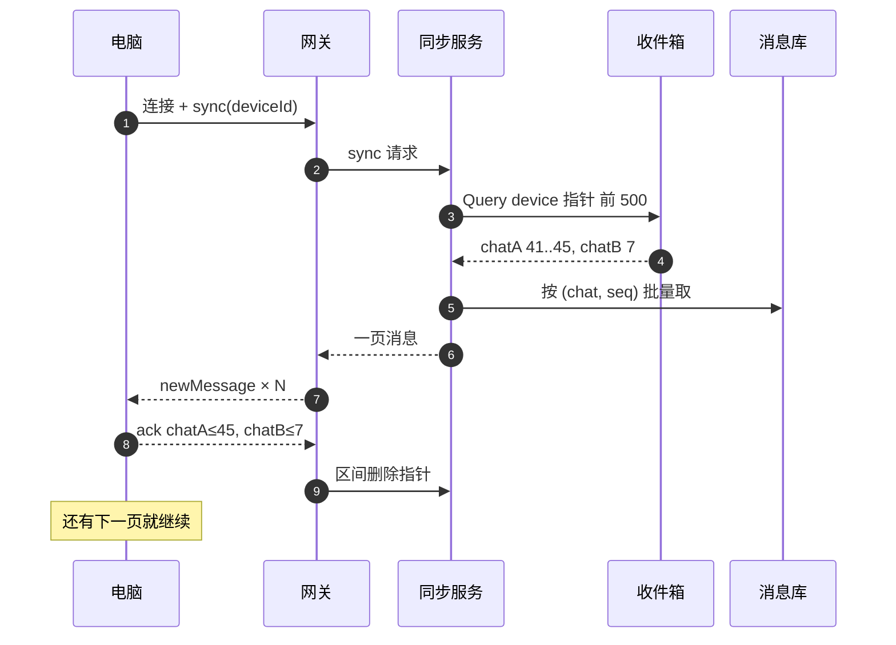
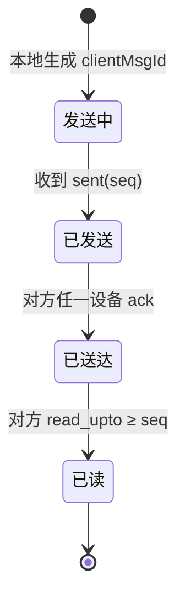

## Q
**离线补收、多设备与回执**｜完整答案 · 即时通讯（WhatsApp）

面试官：「用户的电脑关机三天，手机一直在线。电脑开机后怎样补齐这三天的消息，又不把手机已经读过的重新提醒一遍？在线的设备漏了一条推送，它自己怎么发现？发送者看到的"已送达"两个勾，是怎么来的？」

## A
**一句话。** 收件箱按设备存指针，每台设备各自 ack、各自删除，手机收没收到和电脑无关；电脑上线发 `sync`，服务端按 `device_id` 分页读指针、批量取正文推下去，设备按会话回「收到第 N 条为止」的累计 ack，服务端整段删指针。在线设备靠心跳里带的「该设备收件箱最新序号」发现漏收；已送达、已读回执也按会话累计，只传「到哪个 `seq`」。

**一次重连同步。**

**步骤。**
1. **同步：** 重连后先发 `sync`，完成前新推送照常接收、按 `seq` 去重；`Query Inbox WHERE device_id = :d LIMIT 500`，三天几千条分页拉，先拉最近有消息的会话；指针只有键，正文按（`chat_id`，`seq`）批量读，多台设备共享一份。新设备登录写 `Device` 表，数量到上限要先移除一台。
2. **累计 ack：** 每个会话只回一个数 `ack{chatA, upto=45}`，服务端一次区间删除该设备在 chatA 上 `seq ≤ 45` 的指针。
3. **已读同步：** 手机发 `receipt{chatA, read_upto=45}`，作为系统消息写给该用户其他设备，电脑同步时一起收到，不会对已读的重复提醒。
4. **回执给发送者：** 每台设备 ack 时记下「该用户在 chatA 已送达到 45」，1:1 会话发送者 45 及以前都变「已送达」；回执经发送者收件箱投递，离线也不丢。

**回执状态。**

**在线设备怎样发现漏收。**
- **心跳带序号：** 设备收件序号 `inbox_seq` 每写一条指针加一，网关 `pong` 带最新值，设备发现自己收到的更小就立刻 `sync`，最多一个心跳周期（约 30 秒）补上。
- **会话内空洞：** 收到 47 没收到 46 就立即拉 46，不等心跳。

**故障。**
- **ack 丢失：** 指针没删，下次再发一遍，客户端按（`chat_id`，`seq`）去重并再回 ack。
- **同步中途断线：** 已 ack 的已删，从剩下的继续，指针本身就是游标，无需保存服务端游标。
- **设备 30 天不上线：** 指针和正文 TTL 到期，上线提示「部分消息已过期」。
- **设备被移除或换机：** 删该设备全部指针；端到端加密下历史只能由主设备加密后传给新设备，服务器解不开。
- **早高峰大量设备上线：** 同步服务限速，按会话最近活跃度先同步最近的，其余后台慢慢拉。

**为什么这样。**
- 收件箱不按用户存：手机 ack 删掉后电脑永远收不到，进度必须分设备。
- 不逐条发回执：群里 100 人 × 每条 × 两种回执，比消息还多，累计 `seq` 压成每会话一个数。
- 不只靠定期轮询：4500 万设备每 30 秒一次就是 150 万次查询/秒，心跳本来就要发，带一个数几乎免费。

