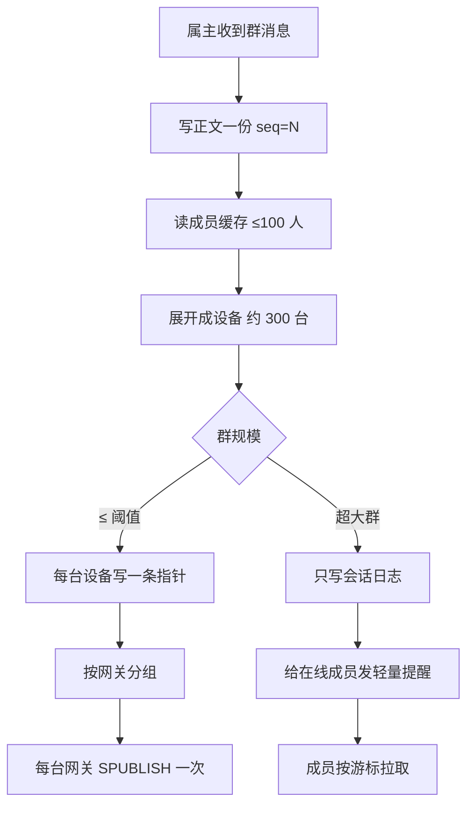

## Q
**群聊：扇出、成员变化与顺序**｜完整答案 · 即时通讯（WhatsApp）

面试官：「100 人的群里发一条消息，服务端具体写几次、发几次？有人刚被拉进群，他能看到进群前的消息吗？有人被踢出去的同时有人在发消息，会不会漏发或多发？如果产品要支持 10 万人的群，设计哪里要改？」

## A
**一句话。** 100 人以内的群用写扩散：正文写一份，给每个成员的每台设备写一条几十字节的指针，再按网关分组发布，一条消息最多几百次小写、几十次发布。成员变化也是会话里的一条消息，占一个 `seq`，由同一个属主串行处理，所以踢人和发消息一定有先后：踢人那条 `seq` 之后的消息不再扇给他，进群那条 `seq` 之前的消息不发给新人。超大群改为读扩散：只写会话日志不写指针，成员按会话游标自己拉。

**一条群消息的扇出。**

**步骤。**
1. **扇出：** 属主内存里缓存成员和设备列表，成员变化时自己更新，读成员不访问数据库；写正文一份、指针约 100 人 × 3 台 = 300 条（按 `device_id` 分区批量写），再按网关分组，每台一条 `SPUBLISH`，300 台设备最多分布在几十台网关上。
2. **成员变化走同一条序列：** `modifyMembers` 作为系统消息分配 `seq = K`，属主先更新成员缓存再处理下一个 `seq`：被踢的人收到 `K` 的「你已被移出」，`K` 之后不再写他的指针；新人 `joined_at_seq = K`，同步和拉历史只返回 `seq ≥ K`。
3. **顺序：** 所有人所有设备按同一个 `seq` 排序；本地「发送中」先显示在末尾，拿到 `seq` 后插到正确位置，几个人同时发言的最终顺序由属主处理顺序决定，所有人一致。
4. **超大群（读扩散）：** 成员超过阈值（如 1,000）不写指针，只写会话日志，给在线成员发合并的「chatX 有新消息到 seq N」提醒（每秒最多一次），成员按会话游标拉；离线成员上线时逐个比较大群列表的游标拉增量。

**故障。**
- **扇出写到一半属主崩溃：** 发送端没收到 `sent` 会重发，新属主查重命中后重放指针写入，键确定所以无害。
- **踢人与发消息并发：** 两者在属主内排队，不存在同时；被踢者离线时 `K` 之前的指针照常有效，`K` 之后根本没写。
- **群从小变大：** 越过阈值时属主在某个 `seq` 切换模式并发系统消息，切换前的指针照常投递，客户端两种来源按 `seq` 去重合并。

**为什么这样。**
- 小群不读扩散：每个成员上线都要检查所有会话有没有新消息，几百个会话就是几百次查询；写扩散让「我有什么新消息」变成一次按设备的查询。
- 大群不写扩散：一条消息 10 万 × 3 条指针写放大不可接受，且多数成员不会读；1,000 人活跃群每秒几十条就是每秒几万条指针，读扩散后只剩几十条。

