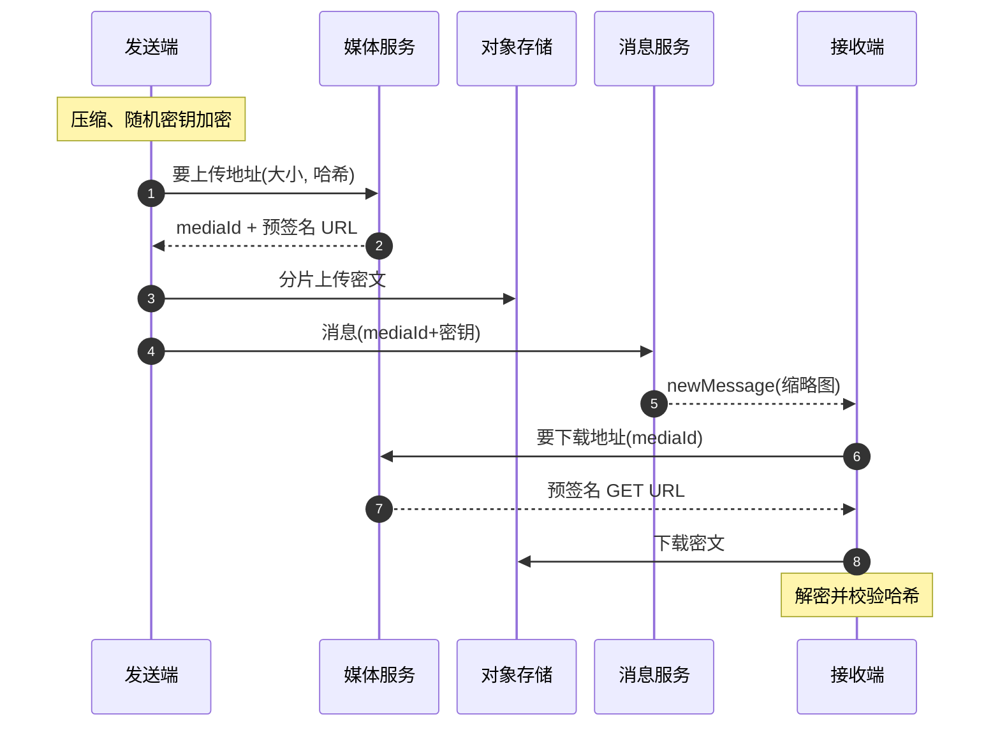

## Q
**媒体：加密、直传对象存储与过期**｜完整答案 · 即时通讯（WhatsApp）

面试官：「用户在群里发一段 50 MB 的视频。字节走哪条路？服务器能看到内容吗？接收方怎么取？发到一半断网怎么办？30 天后这段视频怎么删？」

## A
**一句话。** 发送端用随机密钥加密文件，取预签名地址直传对象存储；消息里只带 `mediaId`、密钥、文件哈希和缩略图，与文字消息走同一条路径。接收方用 `mediaId` 换预签名下载地址，取密文、校验哈希、解密。聊天服务器从不碰媒体字节，对象存储里只有密文，30 天生命周期后删除。

**发送与接收一段视频。**

**步骤。**
1. **加密：** 服务器看不到明文、没法转码，发送端先压缩，再用随机 256 位密钥加密并算密文哈希。
2. **要上传地址：** `getUploadUrl{size, sha256}`；检查大小与配额，返回 `mediaId` 和预签名地址，大文件分片（8 MiB，50 MB 约 7 片）。
3. **直传：** PUT 到 `media/{mediaId}`，签名带哈希，损坏的片被拒收。
4. **发消息：** `sendMessage{mediaId, key, sha256, mime, 缩略图}`，端到端加密下整条消息对每台收件设备分别加密。
5. **接收：** 先显示缩略图；点开时媒体服务验证成员身份，返回几分钟有效的预签名 GET 地址；取回后按哈希校验再解密，不符就重下。
6. **转发：** 复用 `mediaId` 和密钥，不再上传。

**故障。**
- **上传到一半断网：** `ListParts` 查出缺的片，只补缺的，再 `CompleteMultipartUpload`。
- **上传完没发出消息：** 孤儿对象由 30 天生命周期规则清理，未完成分片用 `AbortIncompleteMultipartUpload` 几天内清理。
- **下载地址泄露：** 几分钟过期，且只有密文，没有消息里的密钥解不开。

**为什么这样。**
- 不经聊天服务器转发字节：网关为小消息和长连接调优，大文件会占满带宽和内存。
- 不存数据库：大对象拖慢复制和备份。
- 不在服务器转码或去重：端到端加密下同一视频被不同密钥加密，密文完全不同。
- 用短期签名加成员校验，不用长期公开链接，群成员被踢后旧链接也会失效。

**数字。** S3 分片 5 MiB 到 5 GiB，最多 10,000 片；上传签名约 1 小时，下载几分钟；媒体保留 30 天，与消息正文一致。
