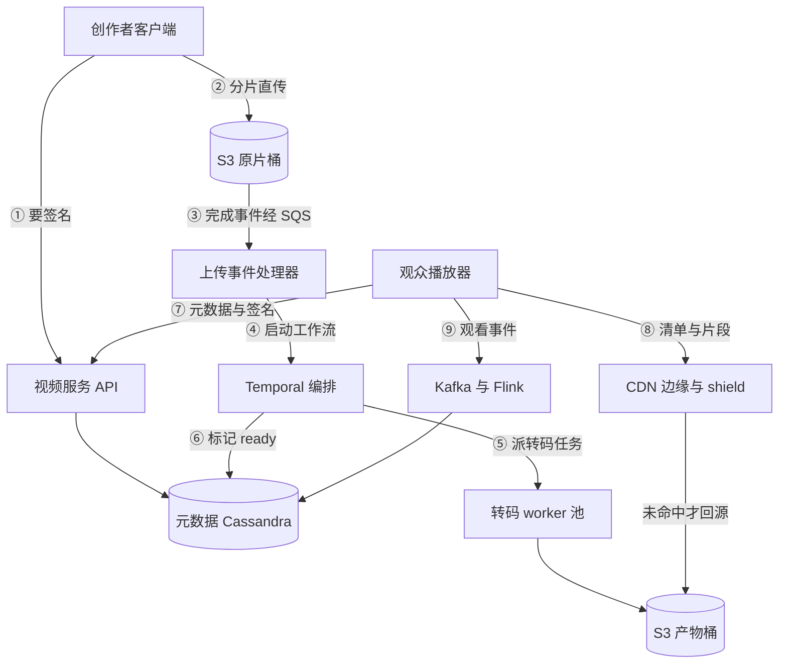

## Q
**全景**｜完整答案 · 视频平台（YouTube）

面试官：「设计一个类似 YouTube 的视频平台：创作者上传视频（可达几十 GB），观众在任何设备、任何网速下流畅观看。每天 100 万个上传、10 亿次观看。从需求讲到深挖。」

## A
**一句话。** 三条互不阻塞的路径：上传字节经预签名 URL 分片直传对象存储（S3）；上传完成事件启动工作流引擎，按关键帧切段、并行转码成多档 HLS/DASH；播放时字节全由 CDN 从 S3 回源，应用服务只发元数据和签名。瓶颈是约 1 TB/s 的出口带宽，不是 QPS。

**需求。** 上传（几十 GB，断点续传）、观看（按网速自动切清晰度 ABR）；不做搜索、推荐、评论、直播。可用性优先，新视频和播放量晚几秒可接受；首帧约 1 秒，上传后约 1 分钟能播（先出低中档）；原片和转码产物不能丢。

**规模。** 每次观看平均传 100 MB，原片 100 MB，峰值 3 倍：

| 项 | 结果 |
|---|---|
| 上传 / 观看 | 约 12 个/秒、1.16 万次/秒，峰值约 35 个、3.5 万次 |
| 出口带宽 | 10⁹ × 100 MB = 100 PB/天 ≈ 1.16 TB/s（9.3 Tbps），峰值约 2.3–3.5 TB/s |
| 入口带宽 | 100 TB/天 ≈ 1.2 GB/s，只有出口的千分之一 |
| 并发流 | 10⁹ × 600 秒 ÷ 86,400 ≈ 690 万路，每 4 秒一段，CDN 约 170 万请求/秒 |
| 新增存储 | 原片 100 TB/天加转码约 2 倍，跨区域副本 ×2，约 600 TB/天、220 PB/年；全套两个编码族可达 6 倍，所以分层转码 |

请求数很小、字节很大：出口靠 CDN，字节放对象存储，应用服务器不碰字节。S3 的多可用区冗余已含在单价里，只有跨区域复制要再乘一份。

**实体与接口。** `Video`（`status`: pending / uploaded / processing / ready / failed）；`VideoAsset` 每（档位，编码）一行各有状态，1080p 就绪时 4K 可以还在排队；`UploadSession` 存 `UploadId`；`ViewCount` 单独分表避免写热点。接口是「元数据换预签名 URL」：`POST /videos`、`parts:sign`、`GET …/upload`（`ListParts` 续传）、`upload:complete`、`GET /videos/{id}`（清单 URL 加 CDN 签名 cookie）、`POST …/views` 回 202。

**架构。**

- **写路径（①–⑥）：** 字节直进 S3，S3 完成事件驱动后面所有处理。
- **读路径（⑦–⑧）：** API 只回元数据和签名，片段走 CDN，CDN 回源 S3。
- **计数路径（⑨）：** 观看事件进 Kafka，流处理按视频聚合后写库，不在请求路径上加一。

**必讲深挖。**
- **上传：** `CreateMultipartUpload` → 预签名 `UploadPart` → `ListParts` 续传 → `CompleteMultipartUpload`；S3 事件以条件更新幂等推进 pending → uploaded。
- **处理：** 每（档位，段）一个任务并行转码，全部完成再打包清单；worker 死了由引擎心跳超时重派，输出 key 固定（video_id，档位，段）所以重做无害。
- **播放：** 主清单列档位，媒体清单列 2–6 秒的段，播放器逐段选档；边缘 → shield → S3 逐层回源并合并并发请求。

**为什么这样。**
- 不经 API 服务器传字节：几十 GB 占满连接带宽，中途断了要重来。
- 不把视频放数据库：大对象让复制、备份、带宽被字节占满，对象存储还能直接当 CDN 源站。
- 不同步转码：以分钟计必须异步；用工作流引擎，故障检测和重试由引擎负责。
- 不整片下载、不用单一码率：整片要等下载完，单一码率网速降时卡顿。
