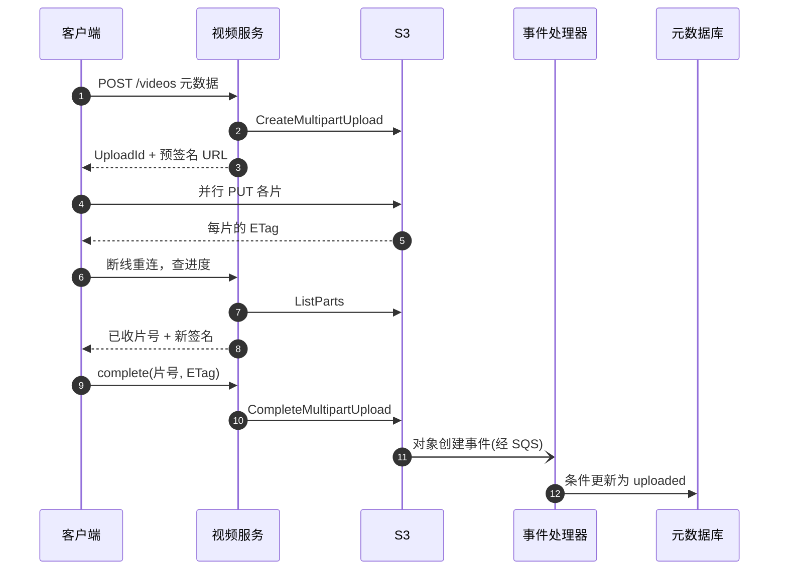
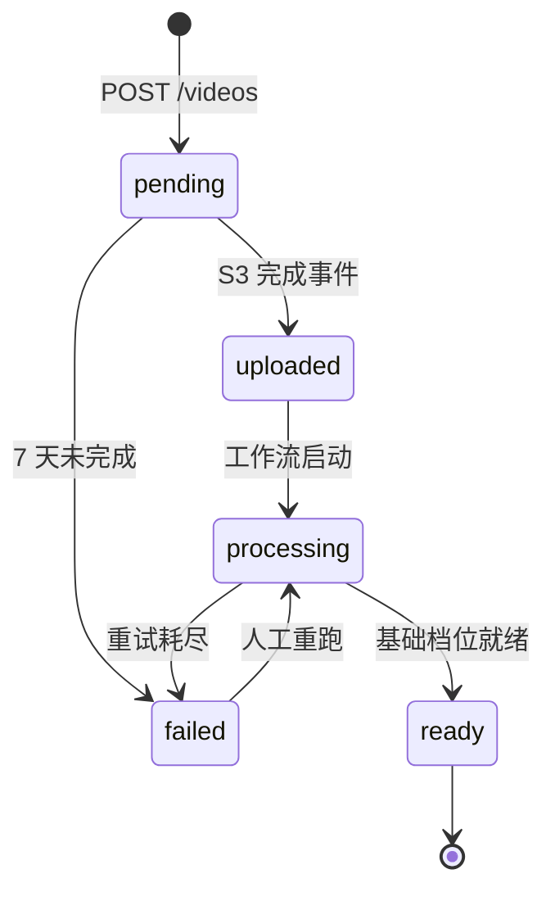

## Q
**上传：分片直传、续传与状态机**｜完整答案 · 视频平台（YouTube）

面试官：「创作者上传一个 20 GB 的视频，传到 90% 断网了。上传走哪条路？怎么续传？服务端怎么知道传完了、又怎么保证只处理一次？」

## A
**一句话。** 视频服务只做控制面：`CreateMultipartUpload` 拿 `UploadId`，按需给每片签发预签名 `UploadPart` URL；客户端并行把片直传 S3，断线后服务端 `ListParts` 告诉它缺哪几片；传完由服务端 `CompleteMultipartUpload`。S3 随后发 `ObjectCreated:CompleteMultipartUpload` 事件，处理器用条件更新把视频从 pending 推到 uploaded，并以 `video_id` 为 Workflow Id 启动处理工作流，重复事件不会触发第二次处理。

**请求流程。**

**步骤。**
1. **建视频与开上传：** `POST /videos` 只带标题和大小，写 `Video(status=pending)`，片大小至少 `文件大小 ÷ 10,000` 并取到 8 或 16 MiB；`CreateMultipartUpload(Key=raw/{video_id}/{upload_id})` 存进 `UploadSession`，返回第一批预签名 URL。签名是 SDK 本地算的（SigV4）不访问 S3，所以分批签、有效期约 1 小时，不必一次签 1 万个。
2. **并行传片：** 同时传 4–8 片，S3 响应头返回该片 `ETag`（浏览器直传要在 CORS 配 `ExposeHeaders: ETag`），客户端把 `{片号, ETag}` 持久化在本地。
3. **续传与完成：** 重连后 `GET /videos/{id}/upload`，服务端 `ListParts`（每页最多 1000 片，`PartNumberMarker` 翻页）返回已收片，客户端只补缺的并换新签名；完成时提交自己记录的列表，服务端 `ListParts` 核对后 `CompleteMultipartUpload`，S3 按片号升序拼成一个对象。
4. **事件与状态：** 事件投到 SQS 标准队列（S3 不能直投 FIFO）；处理器从 key 解析 `video_id`，pending 或 uploaded 才条件更新为 uploaded（`UPDATE … IF status IN (…)` 或 DynamoDB `ConditionExpression`）再启动工作流，Workflow Id `transcode-{video_id}`、冲突策略 Use Existing，成功后才 `DeleteMessage`；其余状态什么也不做。
5. **清理放弃的上传：** 桶生命周期 `AbortIncompleteMultipartUpload`（如 7 天），未完成的片一直计费；清扫任务把超过 7 天仍 pending 的标 failed。

**状态机。**

pending → uploaded 由事件处理器推进，后续由工作流活动推进，超时转 failed 由清扫任务；每步都是 `IF status = <前一个状态>` 的条件更新，重复或迟到的事件成为空操作，状态不倒退。

**故障。**
- **签名过期：** S3 回 403，向服务端重新要签名，片号不变；同一片重传会覆盖，以 Complete 时提交的 ETag 为准，天然幂等。
- **片在路上损坏：** 签名带 `x-amz-checksum-sha256`，内容不符 S3 拒收，客户端重传。
- **Complete 前后服务端崩溃：** 客户端重试，服务端先 `HeadObject`，对象已存在就当成功。
- **S3 事件重复或乱序：** 至少一次投递不保序；每次上传用含 `upload_id` 的新 key，同一 key 上无先后之争，旧事件被条件挡掉。
- **事件处理器宕机：** 消息可见性超时后重投，超过 `maxReceiveCount` 进 DLQ 告警；对账任务把 pending 但 `HeadObject` 已存在的补推一次。

**为什么这样。**
- 不经 API 服务器转发：入口约 100 TB/天全压在应用服务器上，断了从头传。
- 不靠客户端上报进度当真相：库和 S3 实际收到的片可能不一致，`ListParts` 才是真相。

**数字。** 片 5 MiB 到 5 GiB（最后一片可更小），片号 1–10,000，单对象最大 48.8 TiB；100 MB 视频按 8 MiB 约 12 片，100 GB 用 16 MiB 约 6,000 片；每天 100 万个上传约 1,200 万次 `UploadPart`，平均约 140 次/秒；SigV4 预签名最长 7 天，实际给 1 小时。
