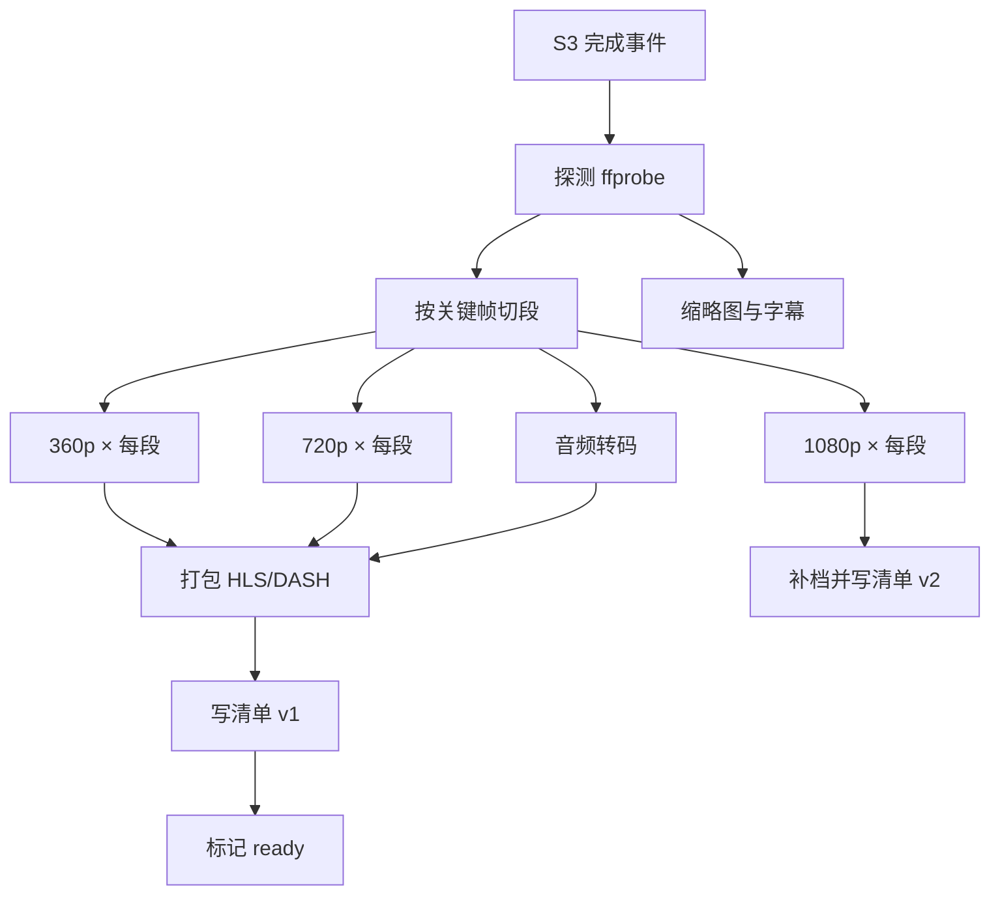
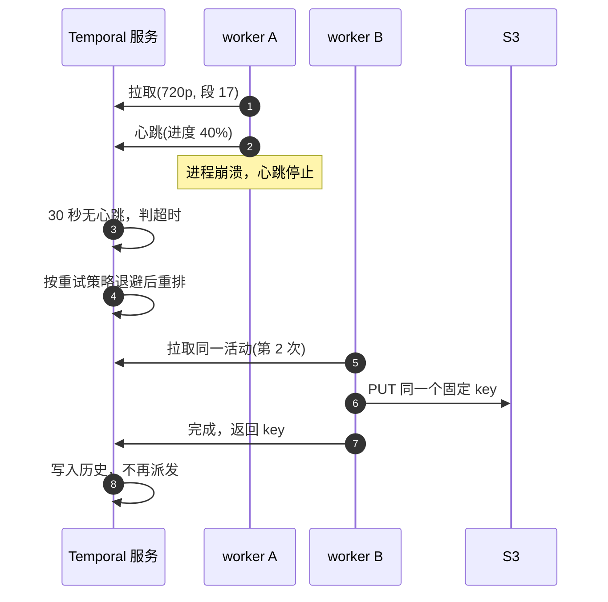

## Q
**处理流水线：DAG 与 worker 故障**｜完整答案 · 视频平台（YouTube）

面试官：「上传完成后，怎么在一分钟内把视频变成多档可播放的 HLS/DASH？转码 worker 做到一半挂了，谁发现、谁接手，结果会不会重复或损坏？」

## A
**一句话。** S3 完成事件启动一个以 `video_id` 为 Workflow Id 的 Temporal 工作流（或 Step Functions）：先把原片按关键帧切成几秒一段，再为每个（档位，段）派一个转码活动，几百个 worker 并行跑；基础档位全部完成后打包 HLS/DASH、写清单、标 ready。worker 死掉由引擎的心跳超时发现，由引擎把同一活动放回任务队列交给别的 worker；输出写到由（video_id，档位，段）决定的固定 key，重做只是覆盖。

**DAG。**

**步骤。**
1. **探测与切段：** `Probe` 用 ffprobe 读时长、分辨率、关键帧，定码率阶梯（不超过原片），为每档写一行 `VideoAsset(queued)` 并推到 processing；`Split` 用 ffmpeg segment 加 `-c copy` 在关键帧处切成约 4 秒的段，不重编码，很快，活动只返回 key 不返回字节。源关键帧太稀（几十秒一个）时先整片转一份固定间隔的中间版再切。
2. **并行转码：** 每（档位，段）一个 `Transcode` 活动进 `transcode-cpu` 队列，worker 主动拉取，从 S3 读源段、ffmpeg 转码（每段以 IDR 开头，各档切点相同 `-force_key_frames`，播放器才能段边界无缝换档）、写固定 key `out/{video_id}/{rendition}/{seg}.m4s`，转码中每几秒带进度心跳。音频整轨转一次，缩略图和字幕并行不阻塞上线。
3. **打包上线：** `Package` 写各档媒体清单（`#EXT-X-ENDLIST`）和 DASH MPD，段用 CMAF（fMP4）一份同时被 HLS 和 DASH 引用；主清单只列已就绪档位，写到带版本路径 `manifest/v1/master.m3u8`；`Publish` 条件更新 `processing → ready`，高档位完成后打包 v2 再改指针，播放端拿到的永远是完整版本，不用清 CDN。`work/` 前缀由生命周期规则清理。

**worker 故障：谁发现、谁接手。**

1. **引擎发现：** Temporal 为每个运行中的活动计时，超过心跳超时（如 30 秒）没收到心跳就判这次尝试失败；没配心跳只能等 Start-To-Close（如 5 分钟）；ffmpeg 退出码非 0 则 worker 立即报错。
2. **引擎重派：** 按重试策略退避后把同一活动放回队列，任何空闲 worker 拉到即接手，你不写协调器。新尝试能读到上次的进度，但转码一段只要几秒到几十秒，整段重做更简单。工作流进程本身崩溃时，另一台 worker 重放持久化的事件历史从原处继续，已完成的活动不重跑。

**故障。**
- **卡死但进程还活着：** 心跳必须绑真实进度（读 ffmpeg 进度输出），不能用独立定时线程，否则卡死的进程永远在「心跳」；Start-To-Close 是最后兜底。

**为什么这样。**
- 不用 Kafka 消费者组派转码：确认只是每分区一个 offset 水位，不能单独确认第 17 条，一个慢任务卡住后面已完成的也提交不了；并行度上限是分区数；分钟级转码超过 `max.poll.interval.ms`（5 分钟）会把健康 worker 踢出组，形成再均衡风暴；也没有逐条重试、退避、扇入。

