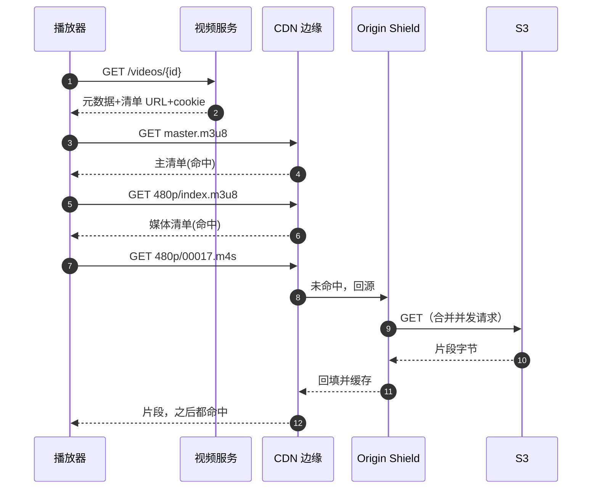

## Q
**播放：清单、ABR 与 CDN 回源**｜完整答案 · 视频平台（YouTube）

面试官：「观众点开一个视频到出画面，请求怎么走？网速变了怎么换清晰度？边缘没有缓存时谁去拿字节，为什么不让你的服务直接发？」

## A
**一句话。** 视频服务只返回元数据、带版本的主清单地址和 CDN 签名 cookie；播放器先取主清单，再取某一档的媒体清单，按 2–6 秒一段从 CDN 拉片段，每取下一段前按吞吐和缓冲重新选档。边缘未命中时 CDN 自己逐层回源：边缘 → 区域缓存 → origin shield → S3，每层合并同一对象的并发请求，一段热门片段只回源一次。应用服务从不经手视频字节。

**一次冷启动播放。**

**步骤。**
1. **元数据与签名：** `GET /videos/{id}` 从缓存读元数据确认 `status=ready`，返回主清单地址 `…/v/{id}/m3/master.m3u8`（`m3` 是清单版本）和 CloudFront 签名 cookie（通配 `/v/{id}/*`，几小时过期；一个视频有上千个清单和段，逐个签 URL 不现实）。边缘用公钥本地验签，不回问视频服务。
2. **清单：** 主清单每档一条 `#EXT-X-STREAM-INF`（`BANDWIDTH`、`RESOLUTION`、`CODECS`），H.264 和 AV1 并列，播放器按 `CODECS` 选能解的；媒体清单列每段 `#EXTINF` 和地址，点播以 `#EXT-X-ENDLIST` 结尾。DASH 用 MPD 表达同样内容。
3. **起播与 ABR：** 没有测速样本先选中低档（如 480p）尽快出首帧；每段下载耗时更新吞吐估计（指数加权平均），选 `BANDWIDTH` 不超过估计 0.8 倍的最高档，缓冲低于下限降档、高于上限才升档（升降阈值不同，防来回跳）；切换只在段边界，各档对齐且每段以 IDR 开头，所以不花屏。
4. **逐层回源与缓存：** 边缘 → 区域缓存 → Origin Shield（离 S3 最近、各区域共用）→ S3（桶只允许 CloudFront 经 OAC 读），每层对在途的同一对象合并请求。段和点播媒体清单内容不变，设 `Cache-Control: max-age=31536000, immutable`；主清单会因补档变化，所以版本放进路径（`m3` → `m4`），新版本是新 URL，不用清 CDN。

**故障。**
- **爆款首次被同时点开：** 请求合并让每个边缘只发一个请求，shield 再合并各区域，S3 每段大约只收一个 GET；S3 前缀过热回 503 SlowDown 时，shield 已挡住绝大部分，key 以 `video_id` 开头天然分散。
- **S3 区域故障：** 跨区域复制留一份，CloudFront 源组在主源 5xx 时自动切副本；CDN 节点故障由 DNS 或 anycast 导到下一个，多 CDN 时调度层切另一家。
- **网速骤降：** 当前段超时则放弃、降档重取，靠缓冲撑过去；cookie 过期边缘回 403，播放器刷新后重试。

**为什么这样。**
- 核心服务不发字节：平均出口约 9.3 Tbps，按每台 25 Gbps、50% 利用率光网卡就要七百多台，峰值再乘 2–3；约 170 万请求/秒全落应用服务则成了每一段的单点，且离用户远、首帧变差。核心服务只做鉴权、元数据、签名。
- 不把所有内容推到所有边缘：长尾视频没人看，默认按需回源，只预热可预测的头部。

