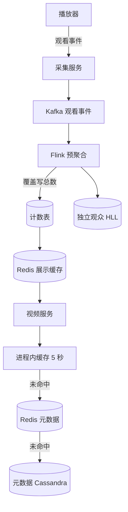

## Q
**元数据与观看计数**｜完整答案 · 视频平台（YouTube）

面试官：「每天十亿次观看，元数据库怎么扛？一个视频爆红时哪里会热？观看次数怎么计：先写 Redis、每分钟刷库，行不行？」

## A
**一句话。** 元数据按 `video_id` 分区放 Cassandra（或 DynamoDB），只做点查，前面挡两级缓存（进程内加 Redis），爆款热 key 靠本地缓存和多副本 key 分散。观看数不在请求路径上加一：播放器发观看事件进 Kafka，Flink 按 `video_id` 预聚合，以覆盖写（不是累加）写进计数表，崩溃后从 checkpoint 和 Kafka offset 重放，不丢不重。Redis 写回式计数在节点故障时丢未刷盘的增量，且无法重放。

**两条路径。**

**步骤：元数据。**
1. **表与分区：** `videos` 主键 `video_id`；`video_assets` 为 `PRIMARY KEY (video_id, rendition, codec)`，一个视频所有档位在同一分区各带状态；`videos_by_uploader` 按时间倒序给频道页，创建时反范式一并写入；计数单独一张表，写热点不拖累元数据读。读都是按 id 点查，哈希天然均匀，一年 3.65 亿行难点只在读。
2. **复制与一致性：** 每数据中心 RF=3，播放读用 `LOCAL_ONE`（可用性优先）；状态迁移用轻量事务 `UPDATE … IF status = 'processing'`（Paxos，多几次往返，但每秒只有十几次）。
3. **读路径与失效：** 进程内 LRU（Caffeine，TTL 5 秒）→ Redis（TTL 几分钟）→ Cassandra，同一 key 并发未命中只放一个去后端（single-flight）防击穿；状态变化时删 Redis key，进程内缓存靠短 TTL 限制陈旧。
4. **热 key：** 进程内缓存让每台实例每 5 秒只问一次 Redis；热 key 复制成 `video:{id}:r0` 到 `r7` 共 8 份随机读；Cassandra `LOCAL_ONE` 读分摊在 3 副本。换 DynamoDB 时单分区约 3,000 RCU/秒，自适应容量把热 item 隔离，再加 DAX。

**步骤：观看计数。**
1. **上报与采集：** 达到观看条件后发 `event_id`（UUID）、`video_id`、`session_id`、时间戳，重试带同一个 `event_id`；采集服务校验限流后写 Kafka `view-events`（`acks=all`、3 副本、`min.insync.replicas=2`），分区键用 `event_id` 或会话而非 `video_id`，免得爆款压一个分区。
2. **去重与预聚合：** Flink 按 `event_id` 去重（状态 TTL 1 小时），每个子任务内先本地预聚合再按 `video_id` 汇总，爆款每个窗口只产生「子任务数」条记录；10 秒事件时间滚动窗口配水位线和允许迟到，累计总数存在键控状态里。
3. **幂等写与 exactly-once：** 窗口结束覆盖写 `views_total = X` 而不是 `+= n`；checkpoint 原子保存 Kafka offset 和状态，故障后回退重算，加覆盖写效果等同精确一次。

**故障。**
- **Flink 崩溃：** 从 checkpoint 恢复重放 Kafka，覆盖写使重复输出无害；采集超时则播放器带同一 `event_id` 重试，Flink 去重；Kafka 生产者开 `enable.idempotence` 防生产端重复。

**为什么这样。**
- 不每次观看 `UPDATE views = views + 1`：平均每秒 1.2 万次不多，但爆款把每秒几万次写压在一行；Cassandra counter 累加不幂等，超时重试会多计。
- 不用 Redis `INCR` 加每分钟刷库：主从异步复制，主挂时副本缺最近的 `INCR`；刷库在「读出增量」和「清零」之间崩溃会多计或丢计；没有事件日志，算错无法重放审计。点赞数这类可有误差的才勉强可用。

