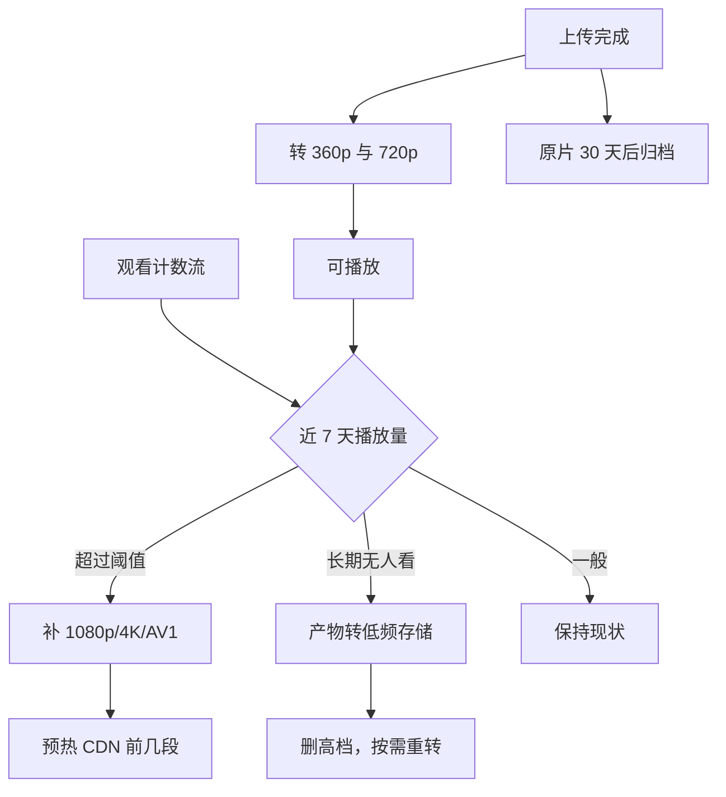

## Q
**热门视频与成本**｜完整答案 · 视频平台（YouTube）

面试官：「一个视频突然爆红，几分钟内上千万人点开，系统哪里先出问题？另外每天 100 万个上传都转全套码率、全放标准存储，钱怎么省？」

## A
**一句话。** 爆款的风险在回源洪峰和元数据热 key，不在 S3 容量：请求合并加 origin shield 让每个对象只回源一次，可预测的热门提前把前几段推到边缘。成本按播放量分层：上传只转低中档，播放量过阈值再补高档和更省带宽的新编码；冷视频降存储级别、删高档、需要时再转；头部流量走自建边缘或议价 CDN，长尾走按量 CDN，多家按质量和价格调度。

**按播放量分层的生命周期。**

**步骤。**
1. **基础档与升级：** 上传只转 360p、720p（H.264），保证一分钟可播且设备都能解；观看计数流水线按视频输出近 N 天播放量和增速，过阈值发升级事件，以 `upgrade-{video_id}-{rendition}` 为 Workflow Id 启动补档（1080p、4K、AV1），写新版本清单改指针，重复事件被 Id 去重。
2. **预热与洪峰：** 可预测的热门（大频道刚发布、趋势急升）从各区域向边缘请求主清单、媒体清单和低中档前几段（商业 CDN 没有通用推送接口，预热就是发请求）；意外爆红靠边缘合并、区域缓存、shield 三层叠加，S3 每段约只收一次 GET，元数据侧靠进程内缓存和多副本 key。
3. **冷数据降级：** 产物用 S3 智能分层，30 天未访问移到低频层、90 天到归档即时访问层，读取不收取回费；原片转码后 30 天转 Glacier Instant Retrieval（毫秒读取，最短计费 90 天），Deep Archive 取回要几小时；长期无人看的视频只留 360p、720p，有人再看时先播现有档位、异步重转高档。
4. **多 CDN 与自建边缘：** 头部流量大且可预测，用自建边缘（Netflix Open Connect、Google Global Cache 这类放进运营商机房的设备）或承诺量 CDN，长尾用按量 CDN；调度层按播放器上报的卡顿率、吞吐和单价在 DNS 层分流，一家变差就切走。

**故障。**
- **冷视频突然爆红、高档已删：** 先用现有档位播放，补档按 Workflow Id 去重，成千上万个请求只触发一次转码，期间旧清单继续可用。
- **小对象太多：** 一个视频几百上千个段，智能分层对小于 128 KB 的对象不分层且按对象收监控费；每档打包成一个 fMP4，清单用 `#EXT-X-BYTERANGE` 引用，对象数从每段一个降到每档一个。

**为什么这样。**
- 不全量转全套阶梯：两个编码族全套约是母版 6 倍存储，算力随上传量线性增长，而播放量重尾，绝大多数视频几乎没人看。
- 不纯按需转码：冷门视频突然爆红时第一批观众全在等转码，队列被打满，所以基础档必须上传即转。

