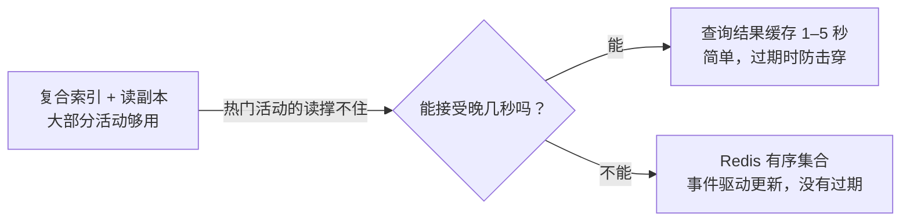

## Q
**有界读｜补强 · 副本和反规范化行不行**

「最近 100 笔捐款」不用 Redis 有序集合，只用读副本加索引，或者把结果存在活动那一行上，行不行？什么时候才该上有序集合？

## A
**结论。** 行，流量不大时它们才是对的做法。有序集合本身就是一种反规范化（denormalization）：差别只在这份算好的结果放在哪里、用什么结构存。

**四种做法。** 每条依次是：每次读做什么；热门活动时怎样；事件重放、乱序时怎样。
- **复合索引 + 读副本：** 查索引，取 100 行；每台副本都重算同一个答案，只能加机器；没影响，查的是真相。
- **查询结果缓存 1–5 秒：** 读 1 个键；过期那一刻大量请求同时回库（缓存击穿）；没影响，最多晚几秒。
- **活动行上存 `recent_100` JSON：** 读 1 个字段；每笔捐款改同一行，抢行锁；要自己去重、排序。
- **Redis 有序集合：** 读 1 个键；单键很快，不锁数据库的行；`ZADD` 同一成员不会重复。

**副本这条路。**
- **索引怎么建：** `(campaign_id, succeeded_at DESC)`，`LIMIT 100` 只扫 100 条；最大 10 笔用 `(campaign_id, amount DESC)`。
- **副本解决什么：** 读的次数多。每次读要做的事没变：一次索引查找，再取 100 行。
- **副本延迟：** 对「最近 100 笔」无所谓，晚一两秒看不出来。

**什么时候升级。**

**面试里这样说。** 「先用复合索引加读副本，大部分活动够用。热门活动的读撑不住时，再把前 N 条预先算好放进 Redis 有序集合，由事件更新，数据库仍然是真相。」

**记法。**
- **副本：** 把整份资料再印一份，每次读还得翻到那一页。
- **反规范化：** 把那一页复印出来。
- **有序集合：** 一张自动排序、不会重复的复印件。
