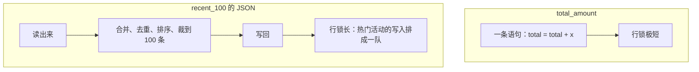

## Q
**有界读｜补强 · 行上能放什么**

活动那一行上存 `total_amount` 通常没问题，存 `recent_100` 的 JSON 却容易出事。两者都要改同一行，差别在哪？

## A
**结论。** 两者都要拿同一行的行锁。差别是锁拿多久，以及同一个事件来两次、或顺序乱了，要不要自己处理。

**逐项比。**
- **一次更新做什么：** 总额是一条语句 `UPDATE … SET total = total + x`；JSON 要读出来，合并、去重、排序、裁到 100 条，再写回。
- **行锁拿多久：** 总额极短；JSON 长，热门活动的写入排成一队。
- **事件乱序：** 加法不看顺序；JSON 要自己按时间重排。
- **事件重放：** 总额会多加一次，靠「只处理一次」挡住；JSON 要自己按 id 去重。

**所以。**
- **等于手写了一个有序集合：** 去重、排序、裁剪，正是 `ZADD` 加 `ZREMRANGEBYRANK` 两条命令做的事。
- **Postgres 还有一层代价：** 每次更新都写出一个新的行版本，JSON 越大，每笔捐款多写的字节越多。
- **行上该放什么：** 一条语句就能原子改完的值：计数、总额、状态。要排序、去重、裁剪的小集合，交给有序集合。
- **总额行也有上限：** 写入再大，这一行自己会变成热点；那时把累加攒成批，或拆成几个分片计数再求和。
