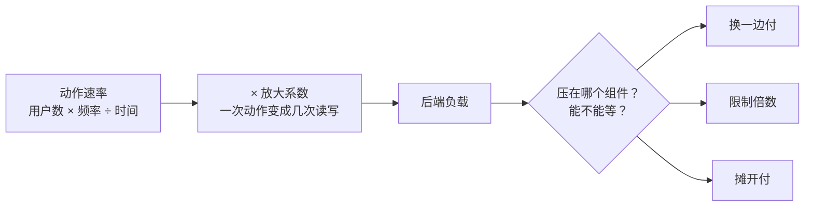

## Q
**任意题目 · 先找放大系数**｜补强

面试官：「你算出每秒两万次写入，就开始讲数据库分片。这是系统里最大的负载吗？」

你会怎么回答？白板上画到哪一步？

## A
**你说。**
- **先问一句：** 「一次用户动作，在后端变成多少次读写？」这个倍数叫放大系数（amplification）。
- **公式：** 后端负载 = 动作速率 × 放大系数。动作速率是用户数 × 频率 ÷ 时间；放大系数要自己找。
- **写扇出：** 一条帖子写进每个粉丝的收件箱，放大系数是粉丝数。
- **读扇出：** 读一次首页去查每个关注对象，放大系数是关注数。
- **任务拆分：** 一次上传拆成 清晰度 × 分段 个转码任务。
- **重试：** 每一跳的次数连乘：三跳各 3 次是 27 次。
- **放大后的数压在哪：** 压在哪个组件，就先设计哪个组件；没放大的那个数通常不是瓶颈。
- **三种对付办法：** 换一边付（推改拉）、限制倍数（封顶、只给活跃用户）、摊开付（进队列，分批异步）。
**白板。**

