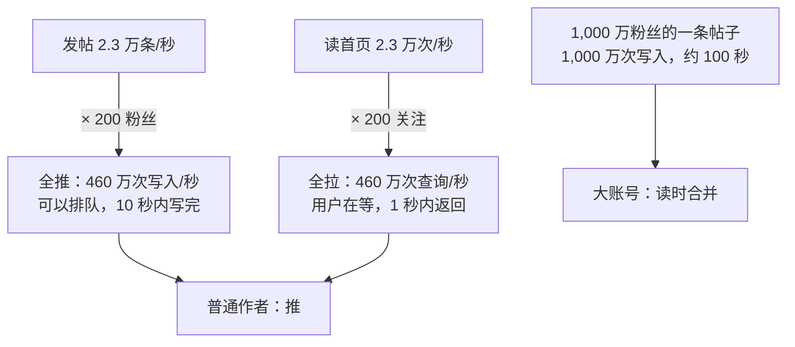

## Q
**信息流 · 用放大系数定推还是拉**｜补强

面试官：「十亿日活，每人每天发 2 条、看 50 条，平均粉丝 200。推还是拉？用数字说。」

你会怎么回答？白板上画到哪一步？

## A
**你说。**
- **发帖速率：** 2 × 10⁹ 条/天 ÷ 86,400 秒/天 ≈ 2.3 万条/秒。
- **读首页速率：** 50 条 ÷ 每页 25 条 = 2 次/人/天，2 × 10⁹ 次/天 ≈ 2.3 万次/秒。50 是条数，不是请求数。
- **全推：** 每条帖子写进 200 个粉丝的收件箱：2.3 万 × 200 ≈ 460 万次写入/秒。
- **全拉：** 每次读首页查 200 个关注对象：2.3 万 × 200 ≈ 460 万次查询/秒。按这组假设，两边一样大。
- **那看哪边能等：** 「写入可以进队列，10 秒内写完就行；读是用户在等，要 1 秒内返回，还要跨分片合并。所以把放大放到写这一边：推。」
- **再看最坏的一个：** 「1,000 万粉丝的一条帖子是 1,000 万次写入，每秒写 10 万条也要 100 秒，超过 10 秒。这类作者不推，读时合并。」
- **落到设计：** 「普通作者推，大账号拉；瓶颈在收件箱的写入和容量，不在帖子库。」
**白板。**

