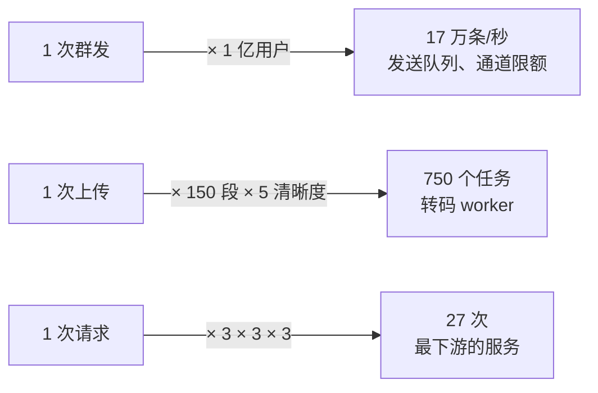

## Q
**三个场景 · 说出放大系数和它压在哪**｜补强

面试官：「三个场景各说放大系数和它压在哪：运营给 1 亿用户发一条通知；用户上传一个 10 分钟的视频；三层服务各重试 3 次。」

你会怎么回答？白板上画到哪一步？

## A
**你说。**
- **通知：** 1 次点击 → 1 亿条消息。10 分钟发完是 100,000,000 ÷ 600 ≈ 17 万条/秒，压在发送队列和下游通道的限额上；分块、限速、可续跑。
- **视频：** 假设 4 秒一段、5 个清晰度：600 秒 ÷ 4 = 150 段，× 5 = 750 个转码任务，压在转码 worker 上；进队列并行，每段幂等。
- **重试：** 客户端、A、B 三跳各最多 3 次：3 × 3 × 3 = 27 次打到最下游的 C，而 C 正是过载的那个；只在一层重试，加重试预算。
- **共同的三步：** 先写出「1 次 → N 次」，再说 N 压在哪个组件，最后说它能不能等。
- **没有放大的时候：** 「每个动作只落一行，放大系数是 1：那就按动作速率设计，不用为它加队列。」
**白板。**

