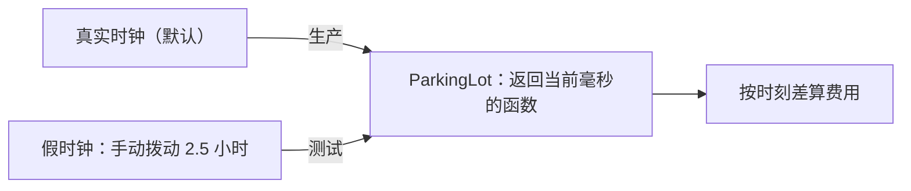

## Q
**停车场 · 怎么测试"2.5 小时后出场"**｜考点 · 必会

不真等 2.5 小时，怎么写测试？用哪种时间？

## A
- **注入时钟：** `ParkingLot` 构造时接受一个返回当前毫秒的函数，默认真实时钟；测试里换成可手动拨动的假时钟。
- **时间的种类：** 费用依据的是日历上的时刻差，用墙上时钟的时间戳（自纪元以来的毫秒）；它与时区、夏令时无关，因为是绝对时间。
- **局限：** 墙上时钟可能被校时回拨；所以计费里把时长夹到非负，或者在系统里用单调时钟记录进场的"已停时长"，各有利弊。
- **要测的点：** 恰好整点、整点多 1 毫秒、2.5 小时、0 毫秒、重复出场、满场、占用集合与票表一致。

