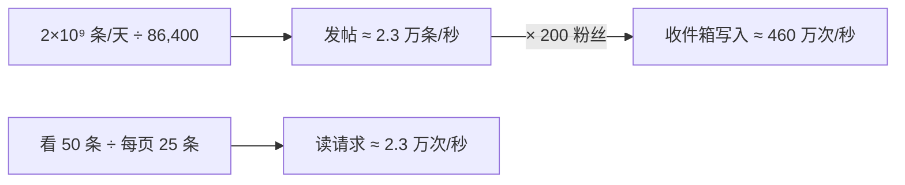

## Q
**这道题的关键数字是扇出**｜模拟面试补强 · 信息流（News Feed）

面试官：「十亿日活，每人每天发 2 条、看 50 条。哪个数字决定你的设计？」

## A
**一句话。** 先定平均粉丝数，再算扇出：每秒约 2.3 万条新帖 × 平均 200 个粉丝 ≈ 460 万次收件箱写入/秒，这才是系统里最大的负载。

**要点。**
- 发帖多少？：2×10⁹ 条/天 ÷ 86,400 ≈ 2.3 万条/秒。
- 读请求多少？：看 50 条、每页 25 条是 2 次请求/人/天，约 2.3 万次请求/秒；50 万是帖子条数，不是请求数。
- 扇出多少？：2.3 万 × 200 粉丝 ≈ 460 万次写入/秒，比发帖本身大两个数量级。
- 这个数说明什么？：SQL 写入不是瓶颈，收件箱的写入和容量才是；要不要推、推给谁都由它决定。

**常见失分。**
- 把 50 万条帖子/秒当成读请求数，又没设粉丝数：扇出、阈值和缓存容量都没法算。开场估算时先说一句“假设平均粉丝 200”。
