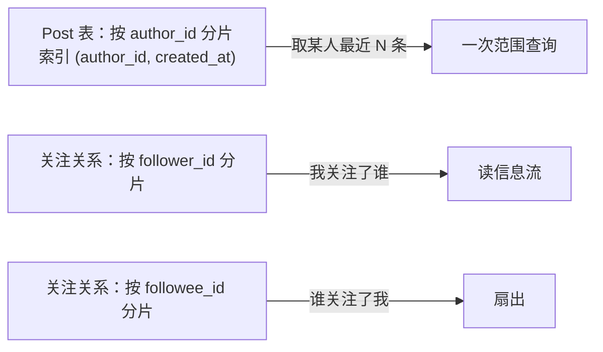

## Q
**帖子表和关注关系怎么存**｜模拟面试补强 · 信息流（News Feed）

面试官：「某人发帖后，你怎么找到他的全部粉丝？又怎么按时间取一个作者的帖子？」

## A
**一句话。** 帖子表要有 `author_id` 和 `created_at`，按 `(author_id, created_at)` 建索引；关注关系两个方向各存一份。

**要点。**
- Post 表有哪些字段？：`post_id`（带时间、全局唯一）、`author_id`、`created_at`、`content`；按 `author_id` 分片，一个作者的帖子在同一个分片。
- 怎么按时间取某人的帖子？：索引 `(author_id, created_at)`，取最近 N 条是一次范围查询。
- 为什么关注关系存两份？：“我关注了谁”读信息流时用，“谁关注了我”扇出时用；只存一个方向，另一个就要扫全表。
- 分片后怎么放？：两份分别按 `follower_id` 和 `followee_id` 分片（或用反向索引），两种查询都只打一个分片。

**常见失分。**
- 白板上 Post 只有 `post_id` 和 `content`，没有作者和时间；关注关系写了“用户行里的列表”和 Follow 表两种，没有收敛；按用户分片后“取所有粉丝”要跨分片，没有处理。画实体时每个表先问一句：读路径要按什么查？
