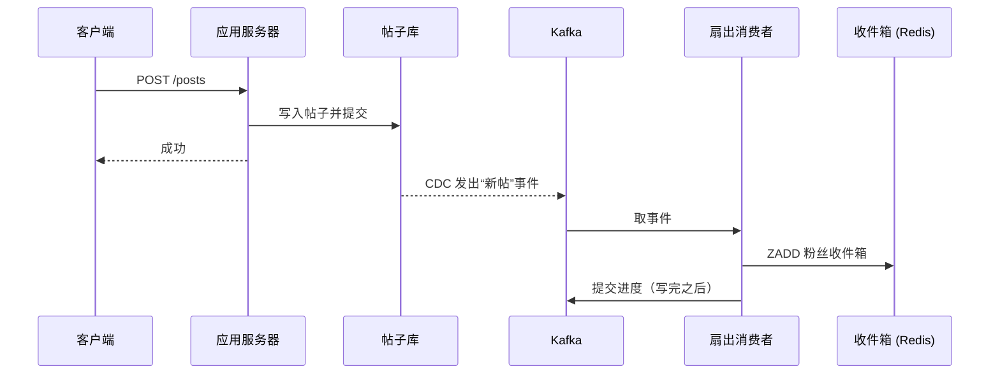

## Q
**帖子存了、扇出前宕机**｜模拟面试补强 · 信息流（News Feed）

面试官：「帖子已保存，应用服务器在更新信息流前宕机，这条帖子怎么到达读者？」

## A
**一句话。** 发帖只做一件事：把帖子写进数据库并提交，然后回成功；扇出由数据库的变更流（CDC）进 Kafka，消费者写完收件箱再提交进度。

**要点。**
- 成功响应什么时候回？：帖子在数据库提交之后；此后帖子不会丢，扇出晚到可以接受。
- 事件怎么保证发出去？：不在应用里“先写库再发消息”两步走；用 CDC 或同事务的发件箱表，库里有帖子就一定有事件。
- 消费者宕机呢？：先 `ZADD` 收件箱，再提交进度；重启后重做同一条，`ZADD` 同一个 post_id 不会重复。
- 10 秒的目标怎么守？：监控消费延迟；大账号按粉丝分页拆成小批次，不让一条明星帖子堵住队列。
- TTL 行不行？：不行。TTL 只会让收件箱过期，补不回漏掉的那一条，重建还要回到跨分片拼接。

**常见失分。**
- 先答 TTL 和 Redis 的 AOF/RDB，这两样都修不了“漏了一次更新”；后来补了 Kafka，但没说成功响应的时机和进度提交的顺序，白板上应用仍直连 SQL 和 Redis。被问宕机，先说“哪一步之后数据就不会丢”。
