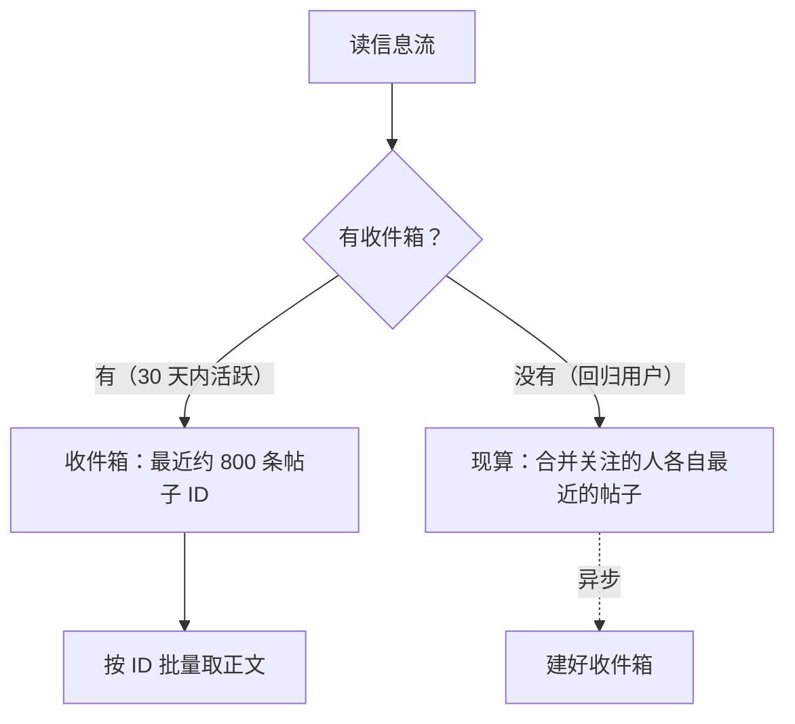

## Q
**收件箱存什么、留多少**｜模拟面试补强 · 信息流（News Feed）

面试官：「每个用户的预计算信息流存什么、留多少条？十亿用户放得下吗？」

## A
**一句话。** 收件箱只存帖子 ID，每人裁到最近约 800 条，只给近期活跃的用户建；正文读时按 ID 批量取。

**要点。**
- 为什么只存 ID？：正文存一份就够；改帖、删帖不用去改上亿个收件箱。
- 怎么保证有界？：`ZADD` 之后 `ZREMRANGEBYRANK` 裁到 800 条。
- 要多少内存？：10⁹ 人 × 800 条 × 8 字节 ≈ 6.4 TB；只给 30 天内活跃的用户建，再降一截。
- 没有收件箱的用户怎么读？：回归用户第一次读时现算：取他关注的人各自最近的帖子合并，再异步建好收件箱。

**常见失分。**
- 说了用 Sorted Set，但没说存 ID 还是正文（原话是“ID 甚至正文”），没有条数上限，也没算内存。说出一个数据结构时，紧跟三件事：存什么、多大、满了怎么办。
