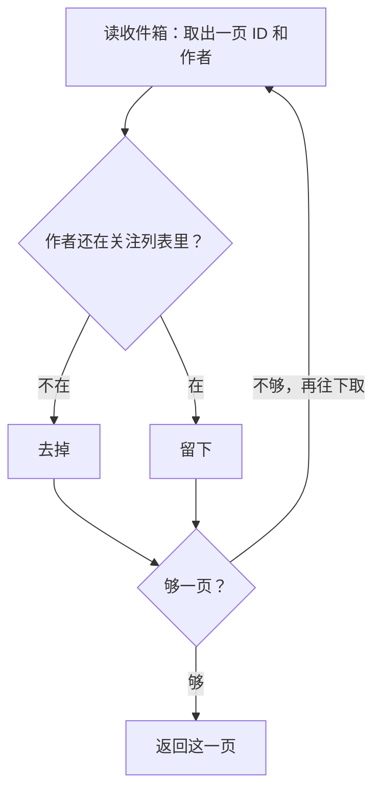

## Q
**取消关注后的收件箱**｜模拟面试补强 · 信息流（News Feed）

面试官：「用户取消关注后，收件箱里那个人的旧帖子怎么办？」

## A
**一句话。** 不去收件箱里删。读的时候用当前的关注列表过滤一遍；关注列表才是事实，收件箱只是派生出来的结果。

**要点。**
- 为什么不立即删？：要在 800 条里找出某个作者的帖子并逐条删，取消关注变成一次重操作。
- 读时怎么过滤？：取出一页 ID 和作者，去掉作者已不在关注列表里的；不够一页就再往下取。
- 新关注一个人呢？：异步把他最近的若干条帖子补进收件箱；补之前读时合并他的近期列表。
- 删帖呢？：同样读时过滤：按 ID 取正文取不到，就跳过。

**常见失分。**
- 收尾时自己提到了“取消关注后预计算结果失效”是风险，但没有给做法。指出一个风险时，至少带一句处理办法。
