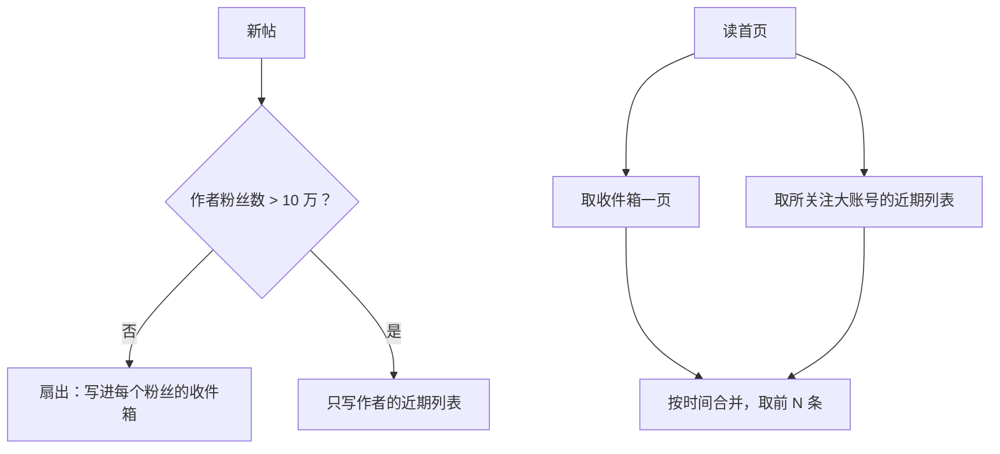

## Q
**混合推拉的线怎么定**｜模拟面试补强 · 信息流（News Feed）

面试官：「粉丝多少算“明星”？你怎么定这条线？」

## A
**一句话。** 用传播目标来定：一条帖子的扇出要在 10 秒内写完。粉丝数超过这个量（常见取 10 万）的作者不推，读时合并。

**要点。**
- 为什么不全推？：1,000 万粉丝的一条帖子是 1,000 万次写入，就算每秒写 10 万条也要 100 秒，超过 10 秒目标。
- 为什么不全拉？：关注 500 人就要查 500 个列表再合并，读是最频繁的路径。
- 明星帖子放哪？：只写作者自己的“近期帖子”列表；这个列表人人都读，放多个副本或进程内缓存。
- 读的时候怎么拼？：收件箱取一页，加上所关注的每个大账号的近期列表，按时间合并取前 N 条。

**常见失分。**
- 主动提出了普通作者推、明星读时合并，这是对的；但没有给阈值，也没有任何数字支撑。说出“混合”之后，补一句线在哪、为什么在那。
