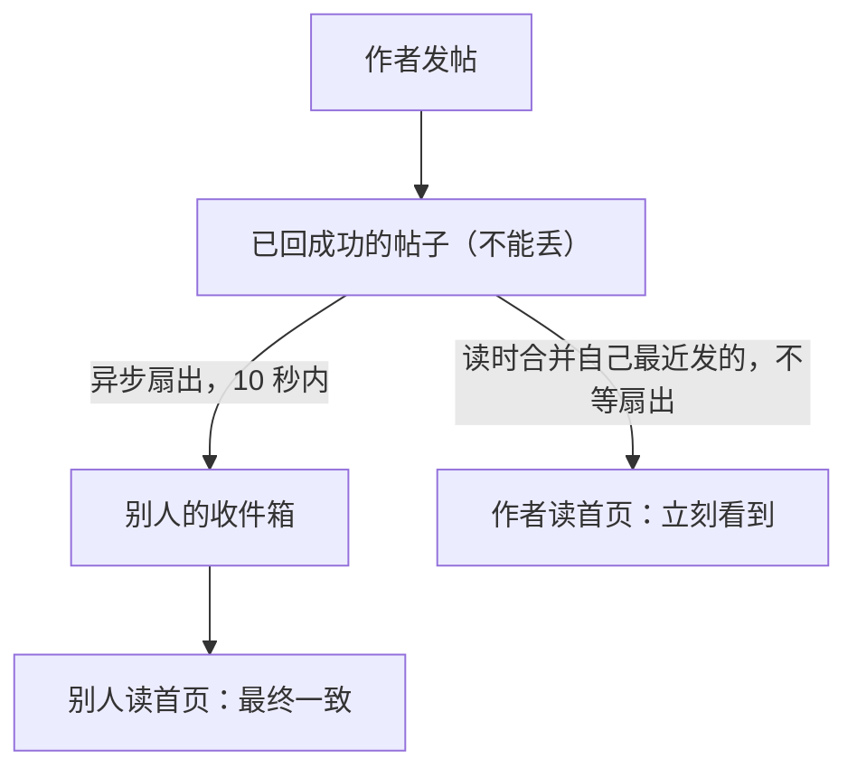

## Q
**先说一致性和可用性的取舍**｜模拟面试补强 · 信息流（News Feed）

面试官：「新发布的帖子多久可以出现在别人的信息流里？」

## A
**一句话。** 信息流选可用性优先、最终一致：别人 10 秒内看到即可；但作者自己发完要立刻看到，关注和取消关注对本人立即生效。

**要点。**
- 为什么可以最终一致？：晚几秒看到一条帖子没有损失，读不出信息流才是事故。
- 作者读自己怎么保证？：读首页时把自己最近发的帖子合并进去，不等扇出。
- 哪些数据不能丢？：已回成功的帖子和关注关系；收件箱丢了可以由这两样重建。
- 延迟目标怎么写？：两个指标分开：读首页 P99 多少毫秒，发帖到可见多少秒。

**常见失分。**
- 非功能需求只给了规模和 1 秒读延迟，传播延迟是被追问后才补的；全程没有说可用性和一致性谁优先，也没说哪些数据不能丢。非功能需求里固定讲四样：规模、延迟、一致性取舍、持久性。
