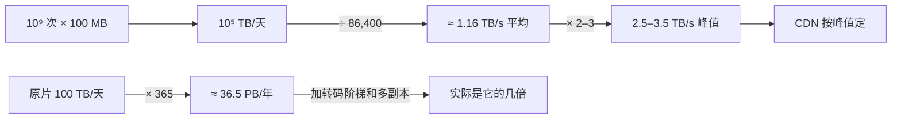

## Q
**带宽和存储算到峰值**｜模拟面试补强 · 视频平台（YouTube）

面试官：「每天 10 亿次观看、每个视频 100 MB，读带宽多少？峰值呢？存储一年涨多少？」

## A
**一句话。** 10⁹ × 100 MB = 10⁵ TB/天，平均约 1.2 TB/s，按峰值 2–3 倍规划 CDN；存储按原片再乘转码副本和冗余。

**要点。**
- 读带宽怎么算？：10⁹ × 100 MB = 10⁵ TB/天，÷ 86,400 ≈ 1.16 TB/s（约 9 Tbps）。
- 峰值多少？：平均乘 2–3，约 2.5–3.5 TB/s，CDN 容量按峰值定。
- 一年存多少？：原片 100 TB/天 ≈ 36.5 PB/年，加转码阶梯和多副本，实际是它的几倍。
- 真实流量会更低吗？：转码码率低于原片、很多人看一半就走，所以更低，但数量级不变：必须上 CDN。

**常见失分。**
- 少算一个数量级：先说 10,000 TB/天，被追问才改；每步写单位，最后做一次数量级复核。
